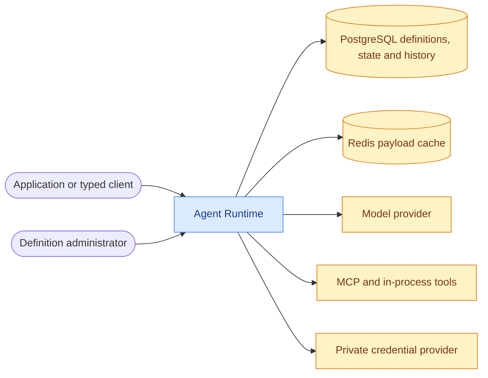

# agentizr

agentizr is a multi-tenant AI agent runtime for .NET 10 applications. It hosts agents backed by
OpenAI-compatible servers, Azure OpenAI or Ollama, with a versioned HTTP API and typed client for
execution, conversation state and controlled definition publication.

[](https://github.com/f2calv/agentizr/actions/workflows/ci.yml)

## Packages

| Package | Purpose | NuGet |
| --- | --- | --- |
| [CasCap.AgentRuntime.Client](src/CasCap.AgentRuntime.Client/README.md) | Typed execution and definition-administration clients | [](https://www.nuget.org/packages/CasCap.AgentRuntime.Client) |
| [CasCap.AgentRuntime.Contracts](src/CasCap.AgentRuntime.Contracts/README.md) | Versioned request and response DTOs | [](https://www.nuget.org/packages/CasCap.AgentRuntime.Contracts) |

## Quick Start

### Connect an Application

Use an existing configured runtime and an identity mapped to its tenant. The
[typed client](src/CasCap.AgentRuntime.Client/README.md) registers
[`IAgentRuntimeClient`](https://github.com/f2calv/agentizr/blob/13aa4a19180b9dbd0f14fa08fbf95f67039b69f0/src/CasCap.AgentRuntime.Client/Abstractions/IAgentRuntimeClient.cs)
through `AddAgentRuntimeClient()`; authentication handlers belong to your application. Install it
with `dotnet package add CasCap.AgentRuntime.Client`.

The smallest execution request is:

```http
POST https://runtime.example.com/api/v1/agents/assistant/runs
Content-Type: application/json

{
  "sessionId": "conversation-example",
  "input": "Summarize the available capabilities."
}
```

Authenticated deployments require a caller-supplied bearer token with `agent.execute`. The response
contains output text, model and definition identity, usage, timing, tool calls and execution events.
Use `/runs/stream` for live events followed by the final response.

### Run from Source

Install the .NET 10 SDK. Release builds use published dependencies and need no adjacent checkouts:

```powershell
dotnet build agentizr.Release.slnx --configuration Release
$env:ASPNETCORE_ENVIRONMENT = 'Development'
$env:ASPNETCORE_URLS = 'http://localhost:5090'
dotnet run --project src\CasCap.App.Server\CasCap.App.Server.csproj --configuration Release --no-launch-profile
```

The tracked defaults start an empty host: `/` identifies it and `/healthz` reports host health.
Before running an agent, add the [Development configuration](src/CasCap.App.Server/README.md#configuration-examples)
and start its model provider. A health response does not verify provider, database or Redis readiness.
Outside Development, PostgreSQL and JWT tenancy are mandatory; Redis is an optional cache.

For local persistence debugging and integration-test infrastructure, use the
[Compose storage/test profiles](docs/persistence.md#local-development-and-tests). They do not
require a GPU or model downloads.

### Local AI Provider Profiles

Docker Compose runs one Agent Runtime with multiple configuration-backed providers and
provider-specific agent definitions. Both provider profiles request an NVIDIA GPU; use a Docker
host with NVIDIA container GPU support. Profiles choose which local provider containers start:

```powershell
# llama.cpp model router: Qwen3.5 4B Q5 text plus 0.8B vision on demand
docker compose --profile llama-cpp up

# Ollama: Qwen3.5 4B
docker compose --profile ollama up

# Both providers (requires enough GPU capacity for both servers)
docker compose --profile all up
```

The single Agent Runtime is exposed at <http://localhost:5090>. Run
`llamacpp` or `ollama` to select a provider through the existing agent route.
llama.cpp is exposed at <http://localhost:11434>; Ollama uses <http://localhost:11435>. On small
GPUs, run only one provider profile at a time. Debug project references require adjacent
`CasCap.Common` and `CasCap.Api.Azure` checkouts; Compose mounts them read-only and builds in its
container-local workspace. Model and NuGet caches use named volumes.

Agent definitions currently select one provider. Runtime overrides may change model and instructions,
but the run API does not accept an arbitrary provider selector. Switching providers for one logical
agent therefore means invoking a provider-specific agent name or publishing and activating a new
definition version. The execution factory and publication policy accept `Ollama`, `AzureOpenAI`
and `OpenAI`; there is no dedicated Azure AI Foundry provider implementation.

## Projects

| Component | Purpose | Delivery |
| --- | --- | --- |
| [CasCap.App.Server](src/CasCap.App.Server/README.md) | Execution, sessions, definition administration and optional status MCP endpoint | ASP.NET Core application |
| [CasCap.AgentRuntime.Client](src/CasCap.AgentRuntime.Client/README.md) | Typed execution and administration clients | Packable .NET 10 library |
| [CasCap.AgentRuntime.Contracts](src/CasCap.AgentRuntime.Contracts/README.md) | Version 1 wire DTOs | Packable .NET 10 library |
| [CasCap.AgentRuntime.Execution](src/CasCap.AgentRuntime.Execution/README.md) | Model clients, tools, delegation and history reduction | Internal project |
| [CasCap.AgentRuntime.Evaluation](src/CasCap.AgentRuntime.Evaluation/README.md) | Fixture tools, grading and recording for definition evaluation | Internal project |
| [CasCap.App.Server.Tests](src/CasCap.App.Server.Tests/README.md) | Protocol, tenancy, state and persistence coverage | Contributor tests; external cases need opt-in/setup |
| [CasCap.AgentRuntime.Execution.Tests](src/CasCap.AgentRuntime.Execution.Tests/README.md) | Provider, tool, compaction and grading coverage | Contributor tests; local model cases are opt-in |
| [agentizr chart](charts/agentizr/README.md) | Runtime and external migration workloads | Helm umbrella chart |
| [agentizr-dashboards](charts/agentizr-dashboards/README.md) | Execution health dashboard | Bundled Helm subchart |

## Configuration

Configuration uses the shared hosting configuration chain, including optional local JSON,
user secrets, environment variables and optional Key Vault. See the
[host configuration reference](src/CasCap.App.Server/README.md#configuration) for names and examples.
`AppConfig` supplies public-safe telemetry defaults in code.

`AgentRuntimeConfig` provides a read-only Development bootstrap adapter. Outside Development,
PostgreSQL owns immutable schema-versioned JSONB definition snapshots and an active-version pointer;
Redis caches immutable definition contents and briefly caches active pointers with bounded expiry.
Provider API keys remain separate from stored `AgentDefinition` values
and must arrive through a private configuration provider.

Outside Development, `TenantAuthenticationConfig` must enable JWT validation with a trusted
authority and audience. Validated caller application identifiers (the `azp` claim by default) map
to logical tenants through an explicit allowlist. Execution requires the `agent.execute` permission;
definition administration uses separate read, publish and activate permissions. Permissions may
arrive through delegated `scope`/`scp` claims or application `roles`. Optional Redis is configured
through `CasCap:CachingConfig:RemoteCacheConnectionString`. PostgreSQL owns sessions, snapshots and
overrides; a durable revision check selects Redis-cached payloads when available. Provider and logical MCP
credentials remain in the final private configuration provider.

Development bootstrap definitions and credentials use immutable startup options. Every state key
includes the definition version, so activating a different PostgreSQL version selects a fresh
namespace while the previous version's durable state remains available for rollback.

Definition publication appends an inactive immutable snapshot. Activation alone advances the active
pointer and appends actor/reason audit history.

Remote MCP tool definitions carry only a logical credential name. The runtime resolves its
tenant-scoped Authorization header from private configuration and creates/disposes the authenticated
MCP client per run.

Development may omit JWT and PostgreSQL. It then uses the configured default tenant and process-local
state for single-process work. Production requires JWT and PostgreSQL. See
[high availability](docs/high-availability.md) for multi-replica coordination and
[persistence](docs/persistence.md) for opt-in PostgreSQL conversation/tool history.

Set `AppConfig__OtlpExporterEndpoint` to an OTLP gRPC endpoint to enable OpenTelemetry export. When it is unset, the shared hosting library skips OpenTelemetry registration.

## Service Architecture

Execution callers and definition administrators use separate permissions. PostgreSQL owns
definitions, runtime state and optional debugging history; Redis caches payloads, not credentials.



## Runtime Boundaries

The host supplies no frontend and does not acquire tokens for its callers. Deployments supply
tenant mappings, allowed provider/tool authorities, credentials and initial definitions.

Version 1 execution accepts optional binary content and session bypass, and returns model identity,
finish reason, timing, token usage, tool-call names, attachments, and structured delegation and
compaction events. Chat-channel delivery and presentation remain the consuming application's
responsibility.

Tools resolve from the current tenant's agent definition. In-process service tools are resolved from
the request scope, remote MCP clients are owned and disposed per run, and sub-agent tools recursively
resolve definitions and credentials through the same tenant-scoped stores.

## Development

For Debug builds, place `CasCap.Common` and `CasCap.Api.Azure` checkouts beside this repository:

```powershell
dotnet build agentizr.Debug.slnx --configuration Debug
```

The test project READMEs above describe categories, source-declared counts, prerequisites and
explicit execution commands. The server suite includes Docker-backed PostgreSQL cases and an
opt-in live-runtime case; it is not entirely credential-free.

The container build/deploy wrappers additionally require PowerShell 7.4+, Docker and the shared
`container-workflows` scripts, installed as a Copilot skill or available in the adjacent central
`.github` checkout. Build the Debug image with adjacent project references:

```powershell
.\build.ps1
```

Copy `deploy.local.psd1.example` to the gitignored `deploy.local.psd1`, set the private GitOps
repository and Application path, then publish the Debug image and chart and patch that Application:

```powershell
.\deploy.ps1 -Chart
```

The chart's `migrate` alias runs `agentizr --migrate` as an external Job; the
[chart example](charts/agentizr/README.md#usage) shows Argo CD PreSync annotations.

Releases from `main` build the Release `Dockerfile` and publish the image and chart to GHCR under
the release version. The Debug wrappers above remain for testing changes to adjacent libraries
before they are published.
The runtime never applies migrations during normal startup.

## Observability

Agent execution metrics use the `agentizr` meter by default and export through the configured OTLP
endpoint. They cover run outcomes and latency, time to first token, provider-reported tokens,
tool calls, and runs whose answer leaked reasoning markup (`<think>` tags) that the runtime removed.
Every series is partitionable by tenant and active definition; bounded provider and
model names are included when a definition resolves. Prompt text, output text, session identifiers,
tool arguments, caller identifiers, and credentials are never metric labels.

The [`agentizr-dashboards`](charts/agentizr-dashboards/README.md) subchart ships the
`Agent Runtime` Grafana dashboard with tenant, agent, provider, and model selectors inside the
application chart. It is enabled by default and can be disabled with `dashboards.enabled=false`.

## Documentation

- [High Availability](docs/high-availability.md): session ownership, definition freshness, failure
  semantics and the prerequisites for a multi-replica rollout.
- [Session Compaction](docs/session-compaction.md): per-provider compaction settings, and the
  measurements of how history size affects local and hosted model latency.

## License

This project is released under the [MIT License](LICENSE).
