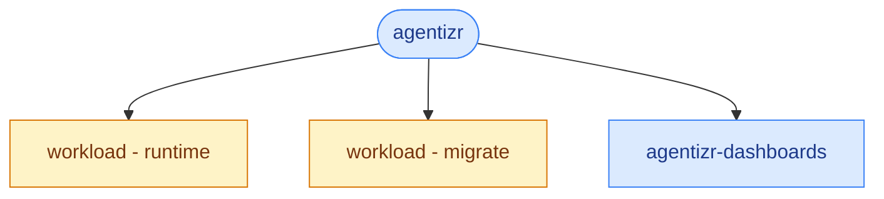

# agentizr

Helm umbrella chart for deploying the CasCap Agent Runtime HTTP service, its external PostgreSQL
migration job and an optional Grafana dashboard to Kubernetes.

## Installation

Every release publishes the chart to `oci://ghcr.io/f2calv/charts/agentizr` and the multi-architecture
image to `ghcr.io/f2calv/agentizr` under the same version:

```powershell
helm upgrade --install agentizr oci://ghcr.io/f2calv/charts/agentizr --version <version> --namespace example-runtime --create-namespace --values runtime-values.yaml
```

Create `runtime-values.yaml` from the example below and supply the required configuration before
enabling workloads. Set `runtime.image.tag` and `migrate.image.tag` to the same release version;
the chart leaves them empty so every deployment selects its image explicitly.

## Overview

The chart aliases the shared `workload` chart twice:

| Alias | Purpose |
| --- | --- |
| `runtime` | Long-running Agent Runtime HTTP service |
| `migrate` | One-shot `agentizr --migrate` job for externally applied migrations |

Both workload aliases default to zero replicas; dashboard rendering is enabled independently.
A deployment supplies PostgreSQL, optional Redis caching, JWT tenancy,
definition publication policy and credential configuration through environment variables and
Secrets, then enables both workloads. Configure the migration Job as an Argo CD PreSync hook so it
completes before the runtime Deployment rolls.

## Usage

```yaml
runtime:
  replicaCount: 1
  image:
    repository: ghcr.io/example/agent-runtime
    tag: "<immutable-image-tag>"

migrate:
  replicaCount: 1
  image:
    repository: ghcr.io/example/agent-runtime
    tag: "<immutable-image-tag>"
  job:
    annotations:
      argocd.argoproj.io/hook: PreSync
      argocd.argoproj.io/hook-delete-policy: HookSucceeded
```

Never place connection strings, authorization headers, API keys or MCP credential parameters in
chart values. Inject them from Kubernetes Secrets.

The runtime listens on container port `8080`, exposed by a ClusterIP Service on port `80`.
Startup, readiness and liveness probes use `/healthz`; this is host health, not a dependency
readiness check. The migration alias is a Job with `--migrate` and no Service or HTTP probes.
Only the example above adds Argo CD hook annotations; they are not defaulted by this chart.

## Configuration

| Value | Default | Purpose |
| --- | --- | --- |
| `runtime.replicaCount` | `0` | Enable the long-running HTTP workload |
| `migrate.replicaCount` | `0` | Enable the external migration Job |
| `runtime.image.tag`, `migrate.image.tag` | empty | Explicitly select the runtime image version for both workloads |
| `runtime.resources` | 50m/128Mi requests; 500m/512Mi limits | Runtime CPU and memory |
| `migrate.resources` | 25m/64Mi requests; 250m/256Mi limits | Migration CPU and memory |
| `dashboards.enabled` | `true` | Include the dashboard subchart |
| `dashboards.dashboardFolder` | `Agentizr` | Grafana sidecar folder |
| `dashboards.datasources.prometheus` | `prometheus` | Existing Prometheus datasource UID |

The workload dependency owns the underlying Deployment/Job, environment and Secret-reference
contract. Both processes need PostgreSQL and valid non-Development authentication configuration;
only the runtime uses optional Redis caching. Configure allowed callers, provider/tool authorities and private
provider credentials using the [host configuration reference](../../src/CasCap.App.Server/README.md#configuration).
The migration Job applies schema only; publish and activate initial agent definitions separately.

The chart does not install PostgreSQL, Redis, a model server, Grafana or a telemetry collector.

## Dependency Graph



## Dependencies

| Chart | Version | Alias |
| --- | --- | --- |
| `oci://ghcr.io/f2calv/charts/workload` | `1.6.0` | `runtime` |
| `oci://ghcr.io/f2calv/charts/workload` | `1.6.0` | `migrate` |
| Local `agentizr-dashboards` | `0.1.0` | `dashboards` |

## Documentation

- [Dashboard configuration and metric contract](../agentizr-dashboards/README.md)
- [Application setup and runtime boundaries](../../README.md)
- [License](../../LICENSE)
