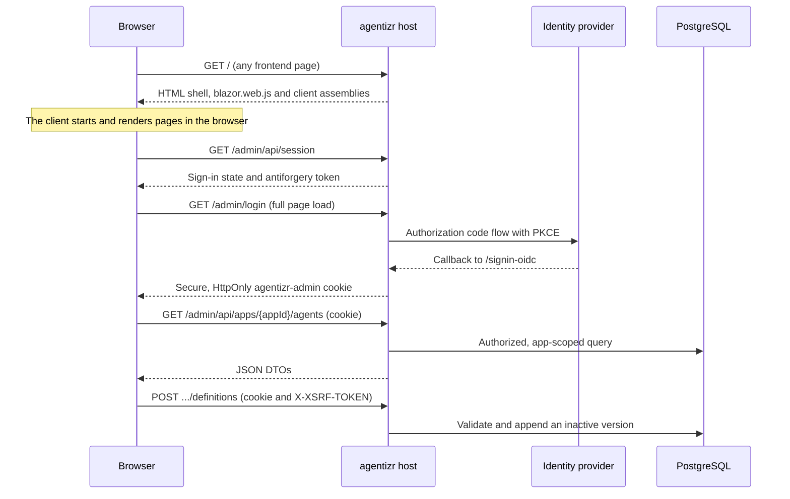

# Administration Frontend

The administration frontend lets an operator discover apps, inspect providers and manage immutable
agent definitions in a browser. It is a Blazor Web App that runs its components only in the
browser with WebAssembly, served and protected by the same host as the runtime API.

## Service Architecture

## How It Fits Together

The work is split across three parts:

- **The host** ([`CasCap.App.Server`](../src/CasCap.App.Server/README.md)) serves an HTML shell from
  `Components/App.razor`, the client's static assets and the JSON API. It owns sign-in, the session
  cookie, authorization and every validation rule.
- **The downloaded client** ([`CasCap.App.Client`](../src/CasCap.App.Client/README.md)) is
  WebAssembly code that the browser downloads and runs. Everything in it is public, so it holds no
  secrets, server configuration or data access. Its pages call
  [`AdministrationApiClient`](../src/CasCap.App.Client/Services/AdministrationApiClient.cs), which
  maps each HTTP status to a typed result that the page renders as loading, empty, forbidden,
  conflict or unavailable.
- **The API** is a set of thin controllers under `/admin/api`, separate from the machine API under
  `/api/v1`. A route such as `/admin/api/apps/{appId}/agents` names the app the browser wants; the
  server checks that the signed-in administrator is assigned to it before that app becomes the
  tenant for the request.

Prerendering is off, so a page never runs on the server. The host stays stateless between
requests: no server circuit holds a user's page, and any replica can answer the next call.

## Publish Versus Activate

Publishing and activation stay separate, as they are in the machine API:

1. **Publish** creates a new immutable, inactive version from the editor. Callers keep using the
   active version. The editor copies an existing version and changes only the fields it edits, so
   tools and other fields without a dedicated control are kept.
2. **Activate** points the agent at one published version, with an audited reason and, where the
   app's policy requires it, a passing fixture evaluation. Rolling back is activating an older
   version.
3. **Deactivate** removes the active pointer, again with a reason, and is refused while another
   active agent delegates to it.

When copying a version, **New version** is prepopulated with today's UTC date and the first unused
revision, such as `2030-01-02.1`. The suggestion checks snapshots outside the bounded history list
and remains editable. A concurrent publication can still claim it; the server rejects duplicates
without changing the existing version.

The editor's **Make this definition active after publishing** checkbox is off by default. Selecting
it changes the submit action to **Publish and activate** and requests confirmation before either
operation. The confirmation includes an activation reason and optional evaluation scenarios,
required when the app's policy demands evaluation. Canceling publishes nothing. Publication still
appends an inactive snapshot first, followed by a separate guarded activation request. If activation
is rejected, the snapshot stays published and can be activated from the agent page; an unknown
activation outcome requires refreshing that page before retrying, not republishing.

The agent page distinguishes the agent's active version from the selected snapshot. Selecting an
inactive version exposes **Activate {version}** in the toolbar; selecting the active version exposes
**Deactivate {version}** instead. Version history retains its per-version activation buttons.
The active pointer is loaded separately, so a version outside the displayed history window is not
mistaken for an inactive agent.

Activation and deactivation send the active version the page displayed. If another administrator
changed it first, the server answers 409 and the page refreshes instead of overwriting their
decision. Replicas may keep serving the previous version for the short active-definition cache
window described in [high availability](high-availability.md).
Publish-and-activate uses the active version observed when the editor loaded; it does not silently
replace a newer administrator decision.

## Built-In Document Preparation Template

On **New agent**, select **Use document-preparation (PdfReconciliationV1)** to start from the
shipped faithful-transcription definition. Replacing an edited draft requires confirmation.
Choose an authorized credential registration, an Azure OpenAI HTTPS root endpoint (or an OpenAI
Responses endpoint), and a PDF-capable model. The template does not select deployment coordinates
or credentials. **Use Responses API** is selected; strict structured output requires that API.

The template's retained definition fields disable runtime discovery/time context, session overrides,
conversation persistence and its own run history, and cap output at 8192 tokens. The editor preserves
those fields when publishing and cloning versions. Activation stays unchecked after choosing a
template. Installing or activating the definition does not enable ingestion or start a paid request.
Complete the runtime rollout before publishing/activating definitions with these new fields.
The durable worker binding and quality gates remain pending in
[ADR 0001](adr-0001-centralized-document-rag.md#built-in-document-preparation-agent).

## Running Locally

In Development with tenant authentication and `AdministrationConfig` both disabled, the frontend is
open without sign-in and shows a banner saying so. Configure PostgreSQL to publish and activate;
the configuration-only Development store is read-only. Browse to the host's root URL, for example
`http://localhost:5090/`.

To test sign-in locally, enable `AdministrationConfig` with a development web registration and run
the host over HTTPS, because the session cookie is always `Secure`.

## When the Frontend Is Not Served

The host serves the frontend only where administrators can use it: with `AdministrationConfig`
enabled, or in Development with both tenant authentication and administration disabled. Elsewhere,
browsing to a page such as `/` returns a setup page instead. It explains the gap, lists each
`CasCap:AdministrationConfig` setting as set or missing without showing any value, and gives the
redirect URIs to register for the requested host. Unknown `/api`, `/admin/api` and `/mcp` paths, and
requests other than GET, still return a plain 404.

When sign-in is enabled but a TLS-terminating proxy's forwarded HTTPS is not being applied,
`/admin/login` returns a setup page naming `ASPNETCORE_FORWARDEDHEADERS_ENABLED` rather than sending
the identity provider an `http://` callback it would reject.

## Proposed Document Management

[ADR 0001](adr-0001-centralized-document-rag.md) proposes app-scoped PDF upload, document management
and ingestion status in this frontend, backed by private Azure Blob Storage and background RAG
processing. These controls are not implemented; the frontend currently manages agent definitions,
not document collections.
