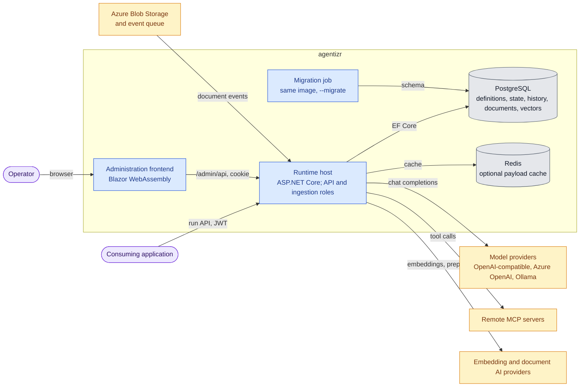
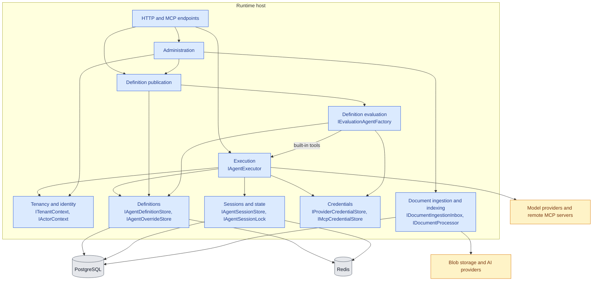
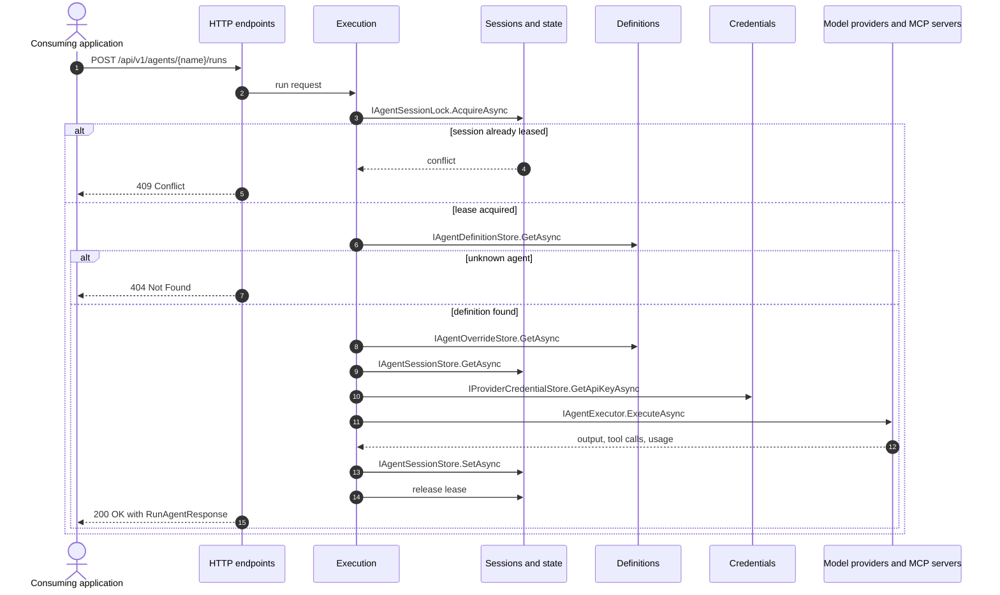

# Architecture

This drilldown explains how agentizr is structured, from its deployable containers to the
components inside the runtime host. The [README](../README.md#system-context) shows the system as a
black box; topic documents linked below hold the detailed runtime flows.

## Containers

One release image provides every agentizr process. Configuration selects its role: the runtime API
(with optional document ingestion), an ingestion-only worker, or a one-shot schema migration. The
[Helm chart](../charts/agentizr/README.md) deploys the runtime as a Deployment and the migration as a
Job. PostgreSQL is the authority for all durable state; Redis only caches payloads.

The runtime host serves the administration frontend's static assets; the frontend then runs in the
operator's browser and calls the host's administration API.

## Runtime Host Components

The runtime host composes components from [CasCap.Backend](../src/CasCap.Backend/README.md),
[CasCap.AgentRuntime.Execution](../src/CasCap.AgentRuntime.Execution/README.md),
[CasCap.AgentRuntime.Evaluation](../src/CasCap.AgentRuntime.Evaluation/README.md) and
[CasCap.Data](../src/CasCap.Data/README.md). Labels list the interfaces each component provides to
the others. The Debug-only runtime logging editor is omitted.

Execution does not query indexed documents yet; document retrieval is described as planned in the
[document RAG lifecycle](document-rag-lifecycle.md).

## Code Map

Most components live in flat folders inside `CasCap.Backend`, identified by file-name prefix.

| Component | Responsibility | Code location | Provides | Requires |
| --- | --- | --- | --- | --- |
| HTTP and MCP endpoints | Version 1 run, session, definition and administration routes; read-only MCP status tool at `/mcp` | `CasCap.Backend/Controllers/`, `Services/AgentizrMcpQueryService.cs`, `Extensions/WebApplicationExtensions.*.cs` | HTTP routes, MCP tools | Execution, Definition publication, Administration |
| Tenancy and identity | Resolves the tenant and actor from validated claims or configuration | `Services/*TenantContext.cs`, `Services/*ActorContext.cs`, `Services/AgentRuntimeAuthorization.cs` | `ITenantContext`, `IActorContext` | Authentication configuration |
| Execution | Runs one agent turn under a session lease, with tools and delegation | `Services/AgentRuntimeApiService.cs`, `Services/AgentExecutionCoordinator.cs`, `Services/CommonAgentExecutor.cs`, `Services/AgentRuntimeBuiltInTools.cs`, `Services/AgentRunHistoryService.cs`, `CasCap.AgentRuntime.Execution` | `IAgentExecutor` | `IAgentDefinitionStore`, `IAgentSessionStore`, `IAgentSessionLock`, `IProviderCredentialStore`, `ITenantContext` |
| Definition publication | Validates, publishes and activates immutable definition versions | `Services/AgentDefinitionAdministrationService.cs`, `Services/AgentDefinitionApiService.cs` | Publication operations | `IAgentDefinitionAdministrationStore`, `IMcpCredentialStore`, `IActorContext`, Definition evaluation |
| Definition evaluation | Grades candidate definitions with fixture tools before activation | `Services/AgentDefinitionEvaluator.cs`, `Services/EvaluationAgentFactory.cs`, `CasCap.AgentRuntime.Evaluation` | `IEvaluationAgentFactory` | `IAgentDefinitionStore`, `IProviderCredentialStore`, Execution built-in tools |
| Definitions | Reads active definitions and runtime overrides, cached in Redis | `Services/*AgentDefinitionStore.cs`, `Services/*AgentOverrideStore.cs`, `Services/AgentDefinitionCacheKey.cs` | `IAgentDefinitionStore`, `IAgentDefinitionAdministrationStore`, `IAgentOverrideStore` | PostgreSQL, Redis |
| Sessions and state | Stores resumable session state and serializes mutations per session | `Services/*AgentSession*.cs`, `Services/*AgentStateStore.cs`, `Services/AgentStateKey.cs` | `IAgentSessionStore`, `IAgentSessionLock`, `IAgentSessionCodec` | PostgreSQL, Redis |
| Credentials | Resolves provider and MCP credentials from private configuration | `Services/Configuration*CredentialStore.cs`, `Services/RuntimeEntraCredential.cs` | `IProviderCredentialStore`, `IMcpCredentialStore` | Configuration providers |
| Administration | Browser administration API, app access and setup | `Services/Administration*.cs`, `Services/Document*AdministrationService*.cs` | `/admin/api` operations | Definition publication, Document ingestion and indexing, `IActorContext` |
| Document ingestion and indexing | Admits blob events, prepares and chunks documents, embeds and publishes vectors | `Services/Document*.cs`, `Services/Pdf*.cs`, `Services/HybridDocumentProcessor.cs`, `Services/AzureDocument*.cs` | `IDocumentIngestionInbox`, `IDocumentProcessor` | PostgreSQL, Blob storage, embedding and preparation providers |
| Persistence model | EF Core context, entities and migrations shared by every store | `CasCap.Data` | `AgentRuntimeDbContext` | PostgreSQL |

## Runtime Scenarios

### Execute a Run

A run holds the session lease for its whole duration, so concurrent runs on one session conflict
instead of interleaving.

### Further Flows

- [Document RAG lifecycle](document-rag-lifecycle.md#data-flow): discovery, preparation, review and
  indexing of documents.
- [Session compaction](session-compaction.md): how history is reduced during long sessions.
- [High availability](high-availability.md): session ownership and definition freshness across
  replicas.
- [Persistence](persistence.md): what each store holds and how schema migrations run.
- [Administration frontend](administration-frontend.md): sign-in and the publish-versus-activate flow.
