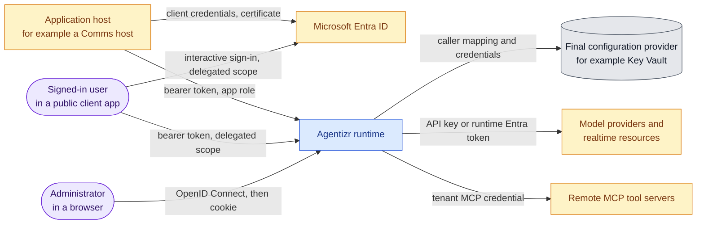
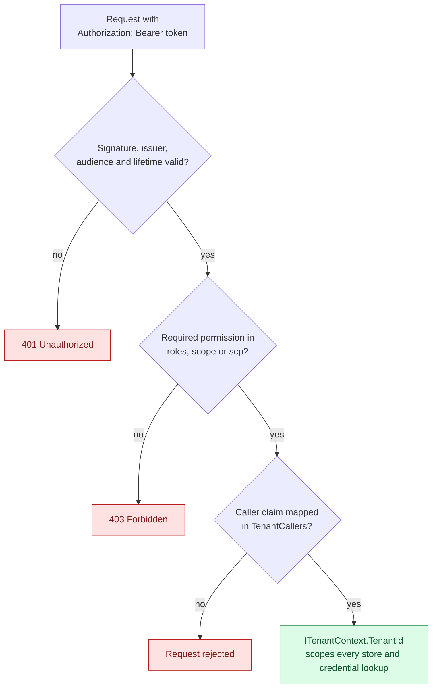
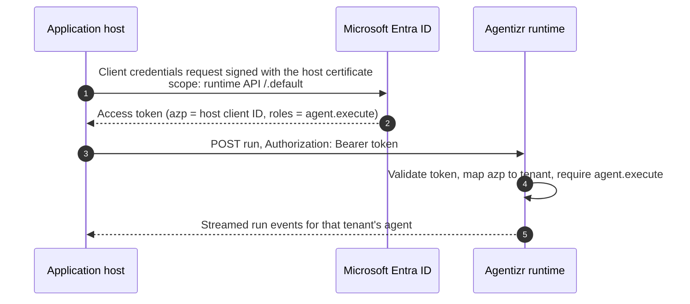
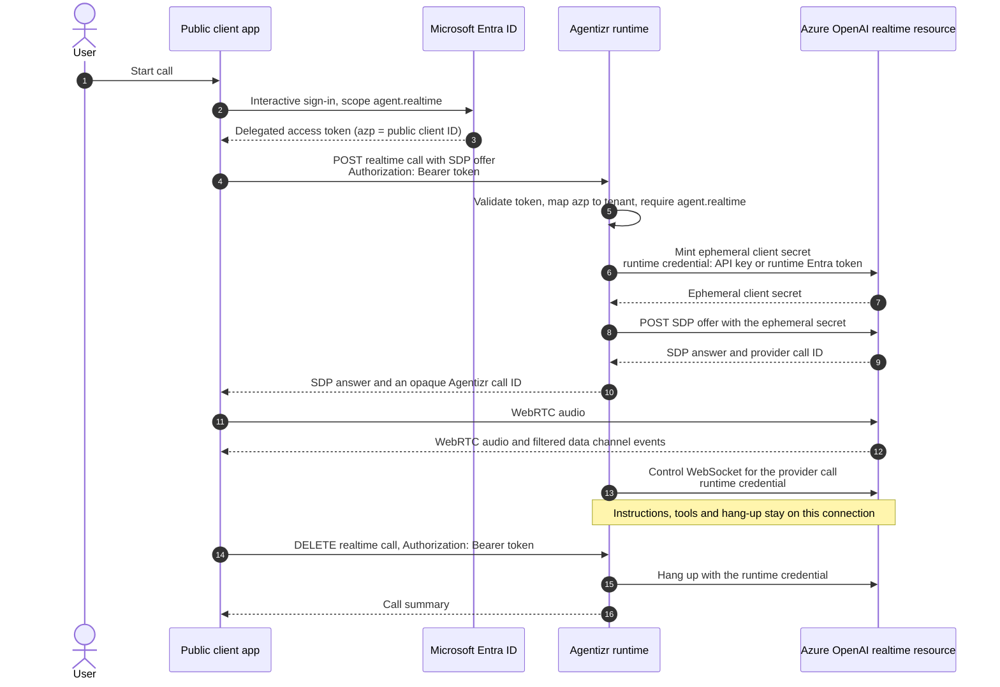
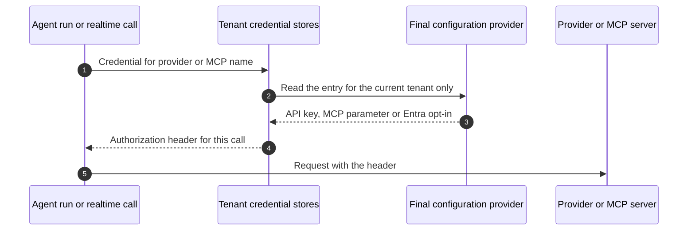

# Authentication

This page explains how callers prove who they are to Agentizr, how the runtime turns a validated
token into a tenant and a set of permissions, and how it authenticates its own outbound calls to
model providers, realtime resources and MCP tool servers. Configuration keys are described in the
[Backend README](../src/CasCap.Backend/README.md#configuration). Every identifier on this page is a
placeholder.

## Identities At A Glance

Three kinds of caller reach the runtime. Each uses a different credential, and none of them can
choose its tenant.

| Caller | Credential | Typical permissions |
| --- | --- | --- |
| Application host | Access token from the client credentials flow with a certificate | `agent.execute` application role |
| Definition publisher | Access token from the client credentials flow, short-lived certificate | `agent.definition.read`, `agent.definition.publish`, `agent.definition.activate` application roles |
| Signed-in user in a public client app | Delegated access token from an interactive sign-in | `agent.realtime` delegated scope |
| Administrator | `agentizr-admin` cookie after OpenID Connect sign-in | App administrator assignment in configuration |

## From Token To Tenant

`TenantAuthenticationConfig` configures JWT bearer validation against a trusted `Authority` and
`Audience`. After validation the runtime reads the caller claim, `azp` by default, which carries the
client ID of the application that requested the token. `TenantCallers` maps each tenant to the
client IDs allowed to act for it, and a client ID can belong to exactly one tenant. The tenant is
derived from that mapping only; request bodies and routes never carry it. The optional
`CallerApplicationNames` maps client IDs to display names for the administration apps page and has
no effect on authorization.

Permissions are read from application `roles` and from delegated `scope` or `scp` claims, so the
same policy accepts either form. Each endpoint group requires one permission:

| Permission | Policy | Grants |
| --- | --- | --- |
| `agent.execute` | `Execute` | Agent runs and tenant-scoped session operations |
| `agent.definition.read` | `DefinitionRead` | Reading definitions and their history |
| `agent.definition.publish` | `DefinitionPublish` | Appending an inactive, immutable definition version |
| `agent.definition.activate` | `DefinitionActivate` | Activating, rolling back or deactivating a version |
| `agent.realtime` | `Realtime` | Starting and ending brokered realtime voice calls |

The runtime API registration exposes `agent.realtime` as a delegated scope only, with no matching
application role, so a realtime call always acts for a signed-in user. Publisher and activation
actor identities also come from validated claims, never from request bodies.

Outside Development, startup fails unless authentication is enabled. In Development with
authentication disabled, endpoints run for `AgentRuntimeConfig.DefaultTenantId` without a token.

## Application Hosts

A host, such as a Comms host that relays chat messages to an agent, has its own app registration
with only the `agent.execute` role and authenticates with a certificate. The host keeps the
certificate and its registration settings in its own secret store; the runtime stores only the
host's client ID in `TenantCallers`.

Publication follows the same flow with a separate registration that holds only the definition
roles. It has no standing credential: a publication run installs a short-lived certificate and
removes it afterwards.

## Signed-In Users And Realtime Calls

A client application, such as a desktop voice client, signs the user in through its own public
client registration and requests the delegated `agent.realtime` scope. The runtime maps the token's
`azp`, the public client's ID, to the tenant like any other caller. The user's token never reaches
the realtime resource, and the client never receives a provider credential.

The ephemeral secret, the provider call ID, the instructions and the tool payloads stay in the
runtime. `DELETE` is checked against the same tenant and agent, so one tenant cannot end another
tenant's call, and any replica can accept it through the
[leased call record](adr-0002-realtime-voice-calls.md#ownership-and-replicas).

## Administrators

The administration frontend signs operators in with OpenID Connect (authorization code with PKCE)
and then uses the secure, HttpOnly `agentizr-admin` cookie. An administrator may act on an app only
when configuration assigns the user's identifier, the `oid` claim by default, to that app; mutations
also require an antiforgery token. Machine bearer tokens never grant administration, and the cookie
never satisfies a bearer policy. The sign-in sequence is drawn in
[Administration Frontend](administration-frontend.md#sign-in-and-definition-publication).

## Outbound Credentials

The runtime authenticates outbound calls with credentials resolved for the current tenant from the
final configuration provider. Definitions name a provider or a logical MCP credential, never a
secret, and publication rejects embedded API keys.

| Target | Credential | Resolved from |
| --- | --- | --- |
| Model provider or realtime resource with keys | `api-key` header | `AgentRuntimeConfig:Tenants:{tenant}:Providers:{name}:ApiKey` |
| Azure OpenAI resource with key authentication disabled | Bearer token for the runtime's own Entra identity | Provider listed in `AgentRuntimeConfig:Tenants:{tenant}:EntraIdProviders`; the identity needs an OpenAI user role on the resource |
| Remote MCP tool server | `Authorization` header with the configured scheme, often Basic | `AgentRuntimeConfig:Tenants:{tenant}:McpCredentials:{name}`; Basic without a parameter uses `CasCap:ApiAuthConfig` |
| Key Vault configuration | Runtime's own Entra identity | `AzureAuthConfig` |

There is no cross-tenant fallback: a tenant without its own entry gets no credential. Credentials
never enter PostgreSQL, Redis, definitions, logs or run history, and a remote MCP server receives
only the header configured for that tenant.

## Registering Identities

A new tenant needs these registrations; use placeholders such as
`00000000-0000-0000-0000-000000000000` in any tracked example.

1. The runtime API registration defines the four application roles and the delegated
   `agent.realtime` scope.
2. Each application host has a registration with a certificate and only the `agent.execute` role.
3. A definition publisher has a registration with only the definition roles and no standing
   credential.
4. A client app that starts realtime calls has a public client registration with a loopback
   redirect URI and the delegated `agent.realtime` permission.
5. Each of those client IDs is added to the tenant's `TenantCallers` entry, held outside tracked
   configuration.
