# Document RAG Lifecycle

This guide follows a PDF from upload to retrieval-augmented generation (RAG): a model answering
with authorized, cited passages from that document. It describes local pgvector indexing and
the remaining retrieval milestone. [ADR 0001](adr-0001-centralized-document-rag.md) remains the architectural decision
record; this guide does not accept or replace that proposal.

**Current boundary:** admission, preparation, immutable review snapshots, saved chunk selections
and document-level readiness assessments are deployed in the Debug workflow. Protected Azure-query
search, source previews and the bounded A1 realtime knowledge tool are implemented and deployed
in the Debug image. One explicitly enabled A1 pilot has successful delegated retrieval and an
operator-reported phone lesson; broader live acceptance remains incomplete. Tracked defaults
remain disabled.
Saving an assessment does not start indexing or make a document available to a model.

Both Debug and Release now compile the same opt-in ingestion, review and indexing implementation.
Release uses verified Common 5.1.0 and Azure 2.0.0 packages. This removes a build restriction only:
the deployment evidence below remains Debug-specific, processing/indexing remain off by default,
and broader retrieval evaluation, general answering-model knowledge bindings and live GPU acceptance remain unfinished.

**Deployed Azure indexing:** protected preflight, separately confirmed durable jobs, non-retrying
Azure embeddings, durable pacing, native pgvector staging and guarded atomic publication are deployed
in the Debug workflow. On 2026-11-05, a separately authorized full replacement published all 65 reviewed
inputs as 3,072-dimensional vectors using five requests and 15,895 reported input tokens.
Processing is back off; both gates still default off. The earlier uncertain job remains quarantined
and unchanged. There is no indexing browser control or general answering-model knowledge binding.

**Local GPU boundary:** llama.cpp is the preferred self-hosted runtime; the separate native Ollama
adapter remains an optional alternative. Read-only discovery found llama.cpp with a chat model loaded and no advertised/configured
embedding model. Its new single-model adapter/binding is implemented and offline-tested, not deployed;
real model identity, pooling and dimensions remain unverified. No download, model switch or GPU
inference is authorized by the completed Azure run or offline implementation approval.
The Ollama examples below describe that adapter, not the discovered GPU deployment.
See the [provider terminology](../README.md#provider-terminology): llama.cpp uses OpenAI-compatible
routes, while the Ollama adapter uses the native Ollama API. Their runtime-specific class/file
names are intentional, not synonyms that should be mechanically renamed.

## RAG Basics: Why Two Models?

Chunking only divides Markdown into manageable passages. It does not yet turn their meanings into
numbers. An **embedding model** performs that mathematical conversion: its trained parameters map
text into a fixed-length list of numbers, called a vector. Related meanings tend to have nearby
vectors. This is inference, not training the model on the uploaded PDFs.

An **answering/chat model** performs a different job: it reads the user's question and retrieved
passages, then writes an answer. These models can come from different providers.

| Step | What happens | Component |
| --- | --- | --- |
| Prepare | Extract and normalize a PDF into reviewed Markdown | Preparation workflow |
| Chunk | Divide approved content into passages, preserving headings and provenance | Agentizr |
| Embed documents | Convert each included passage into a semantic vector | Embedding model, for example `text-embedding-3-large` or the Qwen3 Embedding family |
| Store | Keep vectors and their passage/source bindings | PostgreSQL with pgvector |
| Embed a question | Convert the question into the **same embedding space** | The same pinned embedding model/profile |
| Retrieve | Find nearby eligible vectors and return their passages | Protected exact pgvector search; one authorized A1 query and matching previews verified live |
| Answer | Read the question plus retrieved passages and cite the evidence | Bounded A1 realtime tool; phone smoke reported, broader grounding and general model integration incomplete |

For example, “How do I reset this device?” can match a passage describing a factory reset even if
the wording differs. Vector similarity supplies candidates; it does not prove that the passage is
correct, authorized, current or sufficient. Review gates, source checks and citations still matter.
The chat model receives retrieved **text**, not a raw vector, and does not directly browse the database.
Adding a document updates the knowledge store, not the chat model's weights.

Stored passages and questions must use compatible model identity/revision, dimensions and input
conventions. Equal vector lengths alone do not make different models compatible. An Azure-produced
corpus cannot be searched with a different llama.cpp/Ollama profile's question vector: changing the bound provider/model profile requires
re-embedding the corpus under a new profile and publishing a complete replacement generation.
Vectors still live in pgvector; Azure OpenAI, llama.cpp and Ollama are vector producers, not
alternative vector databases.

“Local Ollama” means the server named by the tenant-authorized endpoint. It may already run in
Docker or directly on a machine; this adapter creates neither. The 4B model's quantized weights
are roughly 2.5 GB, but runtime/context allocations add memory. A 4 GB GPU is not a guaranteed fit,
especially with a chat model resident too. Start with one input per batch and measure memory/latency
before increasing it. The adapter requests unload after each embedding batch; this trades reload
latency for lower idle GPU residency and does not control other callers.

The Azure OpenAI, llama.cpp and Ollama bindings concern the embedding stage. PDF preparation may still use Azure services,
manuals still require verified visual associations, and retrieval rollout/answer integration remain
future work. An implemented adapter does not mean that an end-to-end RAG application has been deployed.

### Protected Search And Source Previews

The local [knowledge service](../src/CasCap.Backend/Services/DocumentKnowledgeService.cs) reuses the
existing Azure embedding transport, tenant credentials, deployment verification and strict response
parser. It does not create an indexing job, deploy another model or re-embed the documents.
The [typed client](../src/CasCap.AgentRuntime.Client/Abstractions/IAgentRuntimeClient.cs) exposes:

- `SearchKnowledgeAsync`: `POST /api/v1/agents/{agentName}/knowledge/search`.
- `GetKnowledgePassageAsync`: `GET /api/v1/agents/{agentName}/knowledge/sources/{indexJobId}/chunks/{ordinal}`.

Both require `agent.knowledge.search`, distinct from execution/realtime permissions. Enabling
`CasCap:DocumentKnowledgeConfig` requires PostgreSQL, bearer tenant authentication (also in
Development), an existing Azure indexing profile and explicit operator-owned bindings. This is a
merge fragment, not authorization to enable inference:

```json
{
  "CasCap": {
    "DocumentKnowledgeConfig": {
      "Enabled": true,
      "Bindings": [
        {
          "TenantId": "example-tenant",
          "AgentName": "example-agent",
          "CollectionId": "example-collection",
          "MaximumCefrLevel": "A1"
        }
      ]
    }
  }
}
```

Each agent has one configured collection; that collection's existing indexing policy chooses the
profile. Requests contain only `query`, optional `maximumResults` (default 3, range 1-8) and optional
`maximumCefrLevel`, which may narrow but never broaden the binding. The query has a 2,000-character
limit and a captured-token ceiling of 128 by default (binding range 1-512), additionally capped by
the profile. The complete search deadline defaults to 30 seconds (range 1-120).
Empty eligible corpora do not invoke embeddings. A nonempty search submits one input once, without
automatic retries; provider failures are explicit 502 responses and search deadline expiry is 504.
Each response reports native embedding input tokens without persisting or logging query text.

Retrieval is an explicit operation, **not an automatic step for every user prompt**. A tutor can
retrieve a topic once and use bounded passages for several turns. Costs include the short query
embedding and retrieved text supplied to the answering model; they are not a second full chat call.
There is no query cache or aggregate durable spending allowance in this slice. The owning service
TODO requires that allowance before unattended/broadly shared enablement; per-request limits do
not cap aggregate requests, client retries or spend across replicas.

The [knowledge store](../src/CasCap.Backend/Services/DocumentKnowledgeStore.cs) checks active pointers,
current source/review/assessment/policy identity, exact included input hashes and vector dimensions.
It releases the source mutation fence before HTTP, then reacquires it and revalidates the observed
generations before ranking. Tenant, collection, profile and reviewed-document CEFR eligibility
precede exact cosine top-k, not a filter over global results. This baseline supports at most
32 active documents per collection; exceeding the bound fails rather than silently truncating.
Only complete bodies up to 8,000 UTF-16 code units with 1-64 source spans are eligible for delivery.
Over-limit passages are excluded before ranking, not truncated after selection.
Source previews reauthorize the same generation and return 404 after withdrawal or replacement.
Both surfaces emit `Cache-Control: no-store`; citations contain opaque identities, source hashes and
physical-page/Markdown-block offsets, never signed URLs or internal endpoints.

These are reviewed **document-level** CEFR filters, not word-level validation or a binding to the
learner's progress profile. Passages remain untrusted data. The bounded realtime pilot below supplies
one topic's evidence per call; trusted learner policy, general topic scheduling and live evaluation
of grounded answers and abstention remain subsequent work.
Direct realtime audio cannot satisfy pre-delivery lexical validation merely by adding RAG.

Local Release verification passed 134 offline cases, 94 host/fake-provider cases and 18 native
retrieval cases; 29 existing native indexing cases also passed. The
[test evidence](../src/CasCap.App.Server.Tests/README.md#protected-knowledge-retrieval) distinguishes
HTTP contract/policy checks from direct-service native ranking and fake Azure inference.
Debug host composition and retained net10.0 Release client/contracts builds passed.
The subsequent Debug rollout and explicitly authorized config-only enablement produced one
successful delegated HTTP retrieval with real Azure query inference and matching protected
previews, as recorded below. This is bounded evidence, not broad relevance/latency acceptance.

### Bounded A1 Realtime Pilot

The deployed [call-owned knowledge tool](../src/CasCap.Backend/Services/RealtimeKnowledgeSession.cs)
uses the existing protected search service, not another embedding implementation or a loop through
the public HTTP endpoint. It sends at most one short-query embedding request per voice call.
The model supplies only a topic, never a tenant, collection, model, CEFR level or result count.
The server fixes A1 and at most three passages; invalid text is rejected before the attempt,
but an attempted search consumes the call's allowance even on provider failure or empty results.
Different tool-call identifiers cannot authorize retries. Reuse the evidence across turns.

The operator must enable `DocumentKnowledgeConfig` and set `RealtimeEnabled: true` on the existing
tenant/agent binding. That binding's `MaximumCefrLevel` must be `A1`; other levels are rejected for
this pilot. `MaximumRealtimeDurationMinutes` defaults to 10 (range 1-30), and the smaller of this
limit and the definition's duration ends the call. The immutable active definition must separately
include `search_document_knowledge` in `realtime.tools`, preserving its other intended tool names.
The authenticated caller needs `agent.realtime`. Private or unclassified collections also require
`agent.knowledge.search`; an explicitly public-reference collection does not require the extra
permission for in-call search. Standalone knowledge search and citation preview still require
`agent.knowledge.search`, regardless of classification.
No new Tutorizr MCP tool or realtime request field is needed. The local MAUI update accepts
whitespace-separated scope entries in the existing `ApiScope` setting and splits them for MSAL,
preserving single-scope settings.
Six offline scope configuration cases passed and both MAUI Debug targets built cleanly; these are
not evidence of installed-client sign-in or token claims.

These are illustrative merge fragments, not authorization to enable either feature:

```json
{
  "CasCap": {
    "DocumentKnowledgeConfig": {
      "Enabled": true,
      "Bindings": [
        {
          "TenantId": "example-tenant",
          "AgentName": "example-tutor",
          "CollectionId": "example-vocabulary",
          "MaximumCefrLevel": "A1",
          "MaximumQueryTokens": 128,
          "RealtimeEnabled": true,
          "MaximumRealtimeDurationMinutes": 10
        }
      ]
    }
  }
}
```

```json
{
  "realtime": {
    "tools": ["search_document_knowledge"]
  }
}
```

Instructions tell the tutor to agree one lesson topic, retrieve once, treat passages as untrusted
evidence and abstain on missing/insufficient evidence. The active pilot definition
`2026-11-15.2` requests no unsolicited sources, titles, page numbers or identifiers during normal
tutoring, and an accurate physical PDF page only when the learner explicitly requests a source.
Publication and activation are complete; the resulting spoken behaviour still needs fresh-call
verification. This prompt-only refinement is not a deterministic output filter.
Topic/level changes
require ending the call and starting another: the server rejects additional retrieval attempts,
but does not semantically classify arbitrary speech as a topic change.
This intentionally does **not** use Tutorizr's model-writable estimated level as an access grant.
A consumer-owned trusted learner policy is deferred under the binding's owning TODO.
No text-run, delegation, streaming-history or session-compaction behavior is changed.

The [singleton factory](../src/CasCap.Backend/Services/RealtimeKnowledgeSessionFactory.cs) captures
only the server-resolved tenant, active definition version and operator grant, then creates fresh
async operation scopes after the setup request has ended. Before/after retrieval and at received
speech-start, response-created and response-done events it checks the binding, active version and
current cited sources without further embeddings. A failed check ends the controlled call as
`ControlLost`; source/database unavailability is not permission to keep answering from old evidence.
Passages and tool payloads are not added to durable call records, text-session history or logs.
Knowledge-enabled calls are also excluded from opt-in durable voice conversation retention and
true resume, including derived assistant history. Provider-side audio/transcripts are distinct
from application retention; these checks do not prove immediate erasure of provider context.

This is **not** preventive output validation: WebRTC audio flows directly from Azure and can already
be in flight before a control event is processed. Previously spoken/derived text cannot be recalled.
Strict lexical/grammar guarantees, immediate erasure of provider-side context and broad grounding
acceptance are not established. End a call before intentionally changing topic/level. The per-call allowance
does not cap repeated new calls or multi-replica aggregate spending. Realtime cost summaries still
price only the realtime model; the embedding request has its own native usage and cost.

Local Release validation passed 76 offline service/state/definition cases and 39 host protocol,
metadata and policy cases. Scripted WebSocket tests exercise the real receive/dispatch/output loop,
cited evidence, fresh-ID replay denial and all three revocation-event boundaries. HTTP checks
prove missing knowledge permission causes 403 before provider REST. They do not prove an enabled,
authenticated live voice call, model obedience, citation relevance, injection resistance or latency.

**Bounded live evidence (2026-11-15):**

- Config-only enablement kept the same Debug image. The deployment controller reported
  Healthy/Synced with a successful operation and both replicas healthy/ready.
  The original 65 published vectors remain unchanged; no re-embedding occurred.
- The authorized A1 binding is enabled with a 128-token query ceiling and a ten-minute
  realtime cap, still bounded by the smaller definition duration.
- Scope registration and delegated consent converged. One real delegated retrieval verified
  both required permissions in memory: anonymous HTTP 401, authenticated search HTTP 200,
  three A1 passages and three exact-match protected source previews. The request reported
  four native embedding input tokens and took 7,377 ms. No token, query or passage content
  is recorded here; one measurement is not a latency distribution or an invoice total.
- Immutable definition `2026-11-15.1` enabled the knowledge tool while retaining the original
  eight tools and `gpt-realtime`. The operator reported a successful fresh phone lesson with
  a source-page citation. This is operator-reported smoke evidence, not an independently
  captured full grounding, safeguard or cost evaluation.
- Published/activated successor `2026-11-15.2` changes only the citation-prompt sentence described
  above; the provider/model, nine tools, A1 boundary, duration and one-search allowance are
  unchanged. Active-version read-back verified activation; the updated citation behaviour has
  not yet been verified in a fresh call.
- A read-only call-record check found one recent call ended after 116 seconds with
  `ProviderClosed`. Recorded usage was 22,518 total tokens: 18,524 input text, 1,652 input audio,
  515 output text and 1,827 output audio; 16,384 cached input tokens are a subset, not an
  additional total. The runtime estimated realtime-model cost was EUR 0.1686, not an actual
  billed charge. It excludes the separate four-token query-embedding request above.
  This aggregate record does not independently verify which spoken statements were grounded.

The public ingress remains voice-only; the runtime built-in calls the search service directly
and does not require a new public knowledge endpoint. Bounded query success does not authorize
further inference or broader rollout.

**Next acceptance:** verify the revised citation behaviour in a fresh, separately authorized
call. Compare expected evidence, actual spoken answers, citations on request, abstention,
topic restart, interruption, revocation, replay denial, context disposal and cost/latency with
a no-retrieval baseline before broader use. These checks are not all observed yet.

## Data Flow

**Current** means deployed in the Debug workflow, subject to configuration and authorization,
not enabled for every collection. **Implemented** means code exists but enablement or live
acceptance remains pending. **Planned** means unimplemented.
**Blocked** means no downstream publication is permitted.
Labels carry these distinctions independently of color.

```mermaid
flowchart TD
    subgraph intake["1. Originals and discovery"]
        Upload["Current: operator uploads PDF"]
        BrowserUpload["Planned: Blazor upload and management"]
        Blob[("Current: private Blob original")]
        Event["Current: Event Grid to Storage Queue"]
        Sync["Current: startup, scheduled or manual reconciliation"]
        Admission["Current: validate mapping and source identity"]
        Job[("Current: durable inbox, source and preparation job")]
        Upload --> Blob
        BrowserUpload -.-> Blob
        Blob --> Event --> Admission
        Blob --> Sync --> Admission
        Admission --> Job
    end

    subgraph preparation["2. Explicitly enabled preparation"]
        Prepare["Current: bounded worker with pinned preparation plan"]
        Receipts[("Current: immutable provider receipts")]
        Snapshot[("Current: normalized Markdown and review snapshot")]
        PrepareFailure["Current: explicit failure or reconciliation required"]
        Job --> Prepare --> Receipts --> Snapshot
        Prepare -->|Failure or unknown paid outcome| PrepareFailure
    end

    subgraph review["3. Human review and readiness"]
        Selection["Current: save included and excluded chunks"]
        Assessment["Current: save classification, attestations and rationale"]
        Ready{"Current: readiness gates pass?"}
        Hold["Blocked: correct or re-review; manuals need verified visual associations"]
        Snapshot --> Selection --> Assessment --> Ready
        Ready -->|No or stale| Hold
        Hold -.->|After correction| Selection
    end

    subgraph indexing["4. Deployed Azure indexing and publication"]
        Policy{"Current: trusted policy, profile and current revisions pass?"}
        Manifest["Current: exact included-chunk input manifest"]
        Authorize["Current: separate confirmation and request/token allowance"]
        IndexJob["Current: durable indexing job and bounded embedding batches"]
        Staged[("Current: inactive complete pgvector generation")]
        Activate{"Current: recheck eligibility and atomically activate"}
        Vectors[("Current: published pgvector generation")]
        IndexFailure["Current: explicit failure; no partial activation"]
        Ready -->|Yes, but not indexing approval| Policy
        Policy -->|No| Hold
        Policy -->|Yes| Manifest --> Authorize --> IndexJob --> Staged --> Activate
        IndexJob -->|Failure or unknown paid outcome| IndexFailure
        Activate -->|Source or authorization changed| Hold
        Activate -->|Complete and still eligible| Vectors
    end

    subgraph consumption["5. Authorized retrieval and bounded realtime pilot"]
        Request["Current: authenticated consumer search API"]
        Scope["Current: operator binding, document CEFR and per-request limits"]
        Query["Current: reuse existing Azure query embedding"]
        Search["Current: fenced eligibility filters before exact ranking and limit"]
        Evidence["Current: bounded passages and protected source previews"]
        Model["Current: opt-in A1 realtime tool supplies call-owned evidence"]
        Validate["Planned: grounding checks and strict tutoring output validation"]
        Answer(["Current: direct realtime audio; phone smoke reported"])
        Unavailable["Current: explicit retrieval failure; live abstention acceptance pending"]
        Request --> Scope --> Query --> Search
        Vectors --> Search --> Evidence --> Model --> Answer
        Model -.->|Future pre-delivery validation path| Validate
        Validate -.-> Answer
        Search -->|No eligible matches or dependency failure| Unavailable
        Validate -->|Unsupported or invalid answer| Unavailable
    end

    Change["Current: source, review or policy change invalidates indexing eligibility"]
    Vectors -.-> Change
    Change -.->|Implemented query-time checks reject stale generations| Search
    Change -.-> Hold

    classDef current fill:#e8f5e9,stroke:#2e7d32,color:#111111
    classDef planned fill:#e3f2fd,stroke:#1565c0,color:#111111,stroke-dasharray:5 5
    classDef implemented fill:#ede9fe,stroke:#7c3aed,color:#111111
    classDef blocked fill:#fff3e0,stroke:#a64b00,color:#111111
    class Upload,Blob,Event,Sync,Admission,Job,Prepare,Receipts,Snapshot,Selection,Assessment,Ready current
    class BrowserUpload,Validate planned
    class Request,Scope,Query,Search,Evidence,Model,Answer,Unavailable current
    class Policy,Manifest,Authorize,IndexJob,Staged,Activate,Vectors,Change current
    class Hold,PrepareFailure,IndexFailure blocked
```



The diagram is a lifecycle, not one uninterrupted automatic job. Human review, indexing
authorization and model binding are separate decisions. Reconciliation discovers missed changes;
it must not silently authorize paid processing or publication.

## What Each State Means

| State | Meaning | Available now? |
| --- | --- | --- |
| Uploaded | The original is in private Blob Storage; the application may not have admitted it yet. | Operator upload; no Blazor upload/replace/delete yet |
| Admitted | A validated, tenant-qualified source and durable preparation job exist. | Yes |
| Prepared | Receipts and derived review content exist; fidelity still needs review. | Yes, for explicitly enabled preparation |
| Selection saved | A reviewer chose which snapshot candidates to include; excluded candidates and the original are not rewritten. | Yes |
| Readiness approved | The current assessment passes implemented review gates for the exact saved selection. | Yes; the preparation job remains `ReviewRequired` |
| Indexing preflight eligible | Current saved inputs satisfy configured trusted classification/profile and token bounds; a manifest identity can be derived. | Yes, for configured collections; never paid-operation approval |
| Indexing authorized | Trusted policy, exact revisions and separately confirmed logical request/token ceilings permit embedding. | Yes; worker gate remains separate |
| Indexed | Every expected included chunk has a compatible vector in a validated generation. | Verified for the Azure vocabulary pilot |
| Published | A complete generation was atomically selected; its current eligibility must still be checked. | Verified for the Azure pilot; not a search endpoint |
| Searchable | An authorized query can obtain eligible passages. | One bounded A1 delegated retrieval verified live |
| Available to a model | An opted-in agent has an authorized binding and successfully obtains eligible evidence. | A1 tool enabled; operator-reported phone smoke, broader acceptance incomplete |

The two initial document assessments were reported to survive browser refresh. That confirms
the user's persistence check, not that both documents passed readiness or that either is searchable.

## Existing Review Gates

The [review workbench](administration-frontend.md#document-catalogue-and-review) first saves a chunk
selection, then a document-level assessment. The assessment binds the current source, immutable
snapshot and selection revision, with an authenticated audit record.

- Classify document type, content language, optional edition and CEFR where applicable.
  The current **Reviewed language** field means the document's content language, not the
  language used to write the review.
- Explicitly attest provenance, included-content fidelity and safety; supply a rationale and
  request readiness approval. Missing attestations or an empty included selection block readiness.
- Vocabulary lists and exam papers need reviewed CEFR. Classification is reviewer metadata today,
  not an implemented trusted collection policy.
- Device manuals remain blocked until figure/caption/source associations are implemented and
  verified. A checkbox cannot substitute for those associations.
- A changed saved selection makes the assessment stale. Another snapshot does not inherit it.
  Source replacement/deletion revokes access to derived review content.

These are readiness gates, not permission to embed. See the
[assessment contract](../src/CasCap.App.Client/Models/DocumentApprovalRequest.cs) and
[server persistence rules](../src/CasCap.Backend/Services/DocumentPreparationMarkdownStore.Approval.cs).

## Proposed Indexing Contract

The first pilot should use eligible vocabulary material. Device manuals must remain unavailable
until their visual gates are satisfied; exam material also needs its own fidelity and licensing review.
No embedding provider, model, dimensions or spending allowance is selected by this guide.

### Local Preflight Implementation

The protected review API exposes `GET .../generations/{generationId}/indexing-preflight`,
with the same signed-in assigned-administrator boundary and `no-store` response policy as review.
The [typed client](../src/CasCap.App.Client/Services/AdministrationApiClient.cs) and
[request collection](../requests/document-reviews.http) expose the check; there is no new browser
button or live rollout in this slice.

Configure [DocumentIndexingConfig](../src/CasCap.Backend/Models/_DocumentIndexingConfig.cs)
under `CasCap:DocumentIndexingConfig`. It defaults to `Enabled=false`, with empty `Profiles` and
`Collections`; no model is implicitly chosen. Enabled preflight requires:

- A profile with provider registration, model/revision, dimensions, cosine metric, exact snapshot
  tokenizer encoding/version and explicit per-input, total-token and included-chunk ceilings.
- A tenant-qualified collection policy with revision, one trusted document type, language,
  learning-content CEFR ceiling and profile reference. The first slice deliberately rejects
  classification mismatches instead of guessing the type of a mixed collection.

These settings are operator-owned, not supplied by the preflight caller. Invalid settings fail
startup validation. Policy/profile contents are included in the manifest identity, so forgetting
to increment a human-maintained revision does not make changed settings hash-identical.

The server reads current source, exact snapshot, latest selection and latest assessment under the
existing mutation lock. Missing/replaced/deleted sources return 404; unavailable persistence
returns 501. Unresolved policy, review or input gates return 200 with explicit blockers and no
manifest identity. A response also reports the observed active-job predecessor, not a search
authorization. An eligible response contains counts/revisions and the manifest hash, never
the private input text, provider configuration, review rationale or actor identity.

Every response retains `IndexingApproved=false`. Profile metadata/token counts do not verify
deployed model identity, credential authorization, storage compatibility, prices or a monetary
budget. Preflight computes a manifest without persisting an indexing request. Acceptance,
execution and activation revalidate it rather than trusting an earlier successful response.

### Local Durable Indexing Implementation

The [indexing administration service](../src/CasCap.Backend/Services/DocumentIndexingAdministrationService.cs)
adds these signed-in assigned-administrator operations, with antiforgery on POST and `no-store`:

| Method / generation suffix | Contract |
| --- | --- |
| `POST /indexing-jobs` | Confirm the exact manifest hash, logical request/input-token ceilings and explicit observed active job ID/null; return durable 202 with status Location |
| `GET /indexing-jobs/{indexingJobId}` | Return payload-free state, effective currency/publication, staged count, submission intents and received usage |

Copy `observedActiveJobId` from a fresh preflight into `expectedActiveJobId`. Missing confirmation
or insufficient ceilings return 400; changed manifests, policy authority, predecessor or retry
authorization return 409. Identical authorization by the same actor reuses the job without
granting another paid attempt. Preparation jobs and readiness records are not reopened.

The [store](../src/CasCap.Backend/Services/DocumentIndexingStore.cs) commits database-time claims
and paid batch intent before HTTP. Compatible received batches resume without resubmission.
Expired or interrupted work with unresolved intent becomes `ReconciliationRequired`, even if
the caller never observed reservation success. There is no automatic replay or reconciliation
endpoint. Unsubmitted ownership cancellation can safely release back to the queue.

`ProcessingEnabled=false` is separate from `Enabled=false`; enabling preflight does not start
the worker. The existing elected ingestion loop runs at most one bounded batch per cycle.
`ProcessingTimeoutSeconds` defaults to 300 and permits 30–900; cleanup has a separate ten-second
bound. Provider calls are not made while holding a database transaction.

Azure pacing is separate from the immutable profile and paid authorization. Operator settings
`AzureMinimumBatchIntervalSeconds` (default 65, range 65–86400) and `AzureMaximumBatchTokens`
(default 10,000 captured tokens) bound one batch per deployment per quiet interval. Preflight
rejects an oversized fixed batch; reduce `MaximumBatchInputs` rather than silently repartitioning
an authorized generation or granting more requests. Ollama is unaffected.

The [durable pacing gate](../src/CasCap.Backend/Services/DocumentEmbeddingPacing.cs) runs under the
shared mutation lock before claiming and again before reserving intent. It identifies the physical
Azure deployment by cloud/ARM resource ID, not tenant, profile or provider alias. A successful
receipt starts the quiet interval; an unresolved intent conservatively uses its claim deadline
as the latest possible dispatch time. Waiting consumes no request allowance and holds no claim,
transaction or process-local timer. Restarting or replacing the leader does not reset history.
Retirement erases private manifests, so a recent unidentifiable intent temporarily gates **all**
Azure deployments rather than losing its quota history. An unrelated identifiable deployment
can continue while another waits.

These are conservative application admission bounds, not Azure's own token estimator, a monetary
cap or coordination with other applications sharing the deployment. Set the token ceiling within
the verified deployment quota, leave estimator headroom where needed, and retain at least the
quota window plus a margin between batches. HTTP failures report only status and validated numeric
`Retry-After`/`retry-after-ms` metadata; bodies, credentials and provider coordinates are not logged.
Headers are diagnostic only: there is no automatic replay or durable header-based rescheduler.
Even an explicit 429 after intent remains `ReconciliationRequired`, without resetting counters
or inventing a zero-usage receipt. Reconciliation/new authorization and any longer cooldown must
be an explicit operator decision. Do not repair an uncertain job by changing its database rows.

An accepted higher collection-policy revision advances durable authority across replicas;
older accepted revisions cannot dispatch or publish. Equal-revision/different-profile contents
conflict. Configuration edits alone are not distributed policy activation.

The [Azure adapter](../src/CasCap.Backend/Services/DocumentEmbeddingProvider.cs) uses the exact
tenant provider registration, endpoint allowlist and lazy tenant credentials. An explicit `Azure`
profile binding supplies endpoint, deployment name/resource ID and management endpoint; ARM
verification checks the actual account, successful deployment, model and revision before intent.
The first adapter supports `text-embedding-3-small`/`text-embedding-3-large`, compatible dimensions
(up to 1536/3072), `cl100k_base` and at most 8192 tokens per input. Batches default to 16 inputs,
configurable from 1–32. The 2024-10-21 embeddings transport disables redirects and has no retry
policy; responses are capped at 16 MiB. A persisted claim ID is sent for request correlation,
not provider deduplication.

Native receipts must have exact indexes/counts, finite nonzero vectors, matching dimensions and
consistent usage. Request/token allowances are **not a monetary guarantee**: unknown requests may
have been charged, actual usage can differ, and an overrun cannot be undone. Known valid usage is
retained even when late/stale responses cannot publish. Do not select pricing or a paid pilot from
these implementation defaults.

The [migration](../src/CasCap.Data/Migrations/20261030121900_DocumentVectorIndexing.cs)
adds EF-owned jobs, receipts and tenant/source-qualified active pointers. Vector rows are
deliberately SQL-owned: parameterized native vector DML, not a pgvector EF plugin. Model-drift
checks do not validate that raw DDL; native migration/round-trip/constraint tests do.
Every included ordinal, input digest and native dimension is checked before atomic publication;
a changed predecessor produces `Conflict`, not an overwrite.

Source retirement removes pointers/vector rows and clears private manifests while preserving
intent, usage and policy audit metadata. Review/policy changes invalidate effective eligibility;
they do not authorize retrieval through an old pointer. Deploy the migration externally and
upgrade **all source-writing replicas before enabling processing**. Do not assume an older writer
knows how to retire these new derivatives. Runtime identities must not install extensions or
manage schema. The `vector` extension must already exist in every target/test database.

Local validation uses fake Azure HTTP/credentials and an isolated pgvector-capable database.
It proves application/storage contracts, not actual Azure compatibility, paid outcomes, live
deployment, search behavior or model access. The disposable test host is removed after validation;
existing local database services are not upgraded or recreated.

### Local Ollama Embeddings

The [Ollama adapter](../src/CasCap.Backend/Services/DocumentOllamaEmbeddingProvider.cs) uses
the same durable jobs, receipts, budgets, staging and atomic pgvector publication as Azure.
A profile selects exactly one `Azure`, `Ollama` or `LlamaCpp` binding. The registered Ollama provider must be
`Ollama` with the exact configured endpoint, and the authority must be allowed by server policy.
Its chat `ModelName` can remain different; the embedding profile explicitly names its own model.
This first local adapter supports credential-free endpoints on a trusted network, not API-key/Entra
proxies or Ollama cloud forwarding.

Before reservation, bounded `/api/tags` and read-only `/api/show` requests require:

- The exact installed model name/tag and full lowercase SHA256 digest, pinned as `ModelRevision`.
- Local-model metadata, not `remote_host`/`remote_model` forwarding.
- The `embedding` capability and native embedding dimensions matching the profile.

`POST /api/embed` sends only the exact included `EmbeddingText` array, with `truncate=false` and
`keep_alive="0"`. Native full dimensions are used; dimensional reduction is not requested.
The adapter verifies the model tag/digest again immediately before and after submission.
Observed drift rejects publication. These observations cannot prove a tag was not changed and
restored between reads: operators must keep installed tags immutable during jobs and must not
silently replace models behind a load-balanced endpoint. There are no pull/create/copy/delete calls.

Responses require the exact model name, ordered count, finite nonzero vectors and positive native
`prompt_eval_count`. Metadata is bounded to 1 MiB and embeddings to 16 MiB. The existing cooperative
deadline, disabled redirects, suppressed HTTP payload logging and no automatic retry apply.
An interrupted or rejected post-intent operation retains the same conservative reconciliation
boundary as Azure; local computation is not implicitly free of resource limits.

The snapshot tokenizer measures captured input size; it is **not** Ollama's native tokenizer.
Its ceilings are admission/packing checks, not a guarantee of Ollama context length or native usage.
`truncate=false` requires the server to reject an overlong input rather than silently embed a prefix.
Native aggregate usage is recorded and an overrun prevents activation, but computation already
performed cannot be undone.

For an Ollama `qwen3-embedding:4b` example, verify the installed digest and dimensions rather than
copying a chat-model binding. Start with `MaximumBatchInputs=1` for the constrained GPU. This
**profile-only template**, not a complete enablement configuration, keeps a synthetic digest and
tokenizer-version placeholder; both must be replaced with observed values:

```json
{
  "Id": "local-manual-embedding",
  "Provider": "local-ollama",
  "Model": "qwen3-embedding:4b",
  "ModelRevision": "0000000000000000000000000000000000000000000000000000000000000000",
  "Dimensions": 2560,
  "DistanceMetric": "cosine",
  "TokenizerEncoding": "cl100k_base",
  "TokenizerVersion": "replace-with-snapshot-tokenizer-version",
  "MaximumTokensPerInput": 512,
  "MaximumChunks": 5000,
  "MaximumTotalTokens": 100000,
  "MaximumBatchInputs": 1,
  "Ollama": {
    "Endpoint": "http://ollama.example.com:11434/"
  }
}
```

The endpoint/provider name are documentation placeholders, not deployment coordinates. Keep
eligibility/processing off until the real profile, tenant registration, trusted collection policy
and source readiness are verified. No live Ollama call, download, container or rollout was made
for this implementation. Device-manual visual gates are unchanged.

See the official [embedding API](https://docs.ollama.com/api/embed),
[installed-model inventory](https://docs.ollama.com/api/tags),
[model metadata API](https://docs.ollama.com/api-reference/show-model-details) and
[Qwen3 embedding models](https://ollama.com/library/qwen3-embedding).

### Local llama.cpp Embeddings

The [llama.cpp adapter](../src/CasCap.Backend/Services/DocumentLlamaCppEmbeddingProvider.cs) reuses the
same durable authorization, native receipts, staging and atomic pgvector publication. It targets an
already-provisioned **single-model embedding server**, not the existing multi-model chat router.
It does not load/select models through router-management endpoints or infer a model from chat defaults.
Reconfiguring a server, evicting a chat model, downloading a GGUF or running inference requires
separate approval.

The exact tenant provider registration must have `Type=OpenAI`, its explicit endpoint equal to
`LlamaCpp.Endpoint`, no API key and no Entra binding. Its authority must be allowlisted. This is
an embedding-only registration on a trusted network, not an instruction to use the chat SDK.
Credential-bearing proxies and arbitrary OpenAI-compatible servers are not supported.

Before enabling processing, the operator must verify the GGUF's SHA256, mount it immutably, start
llama.cpp with embeddings enabled and the chosen pooling mode, and set its server alias to
`sha256-<full-lowercase-GGUF-SHA256>`. Pin that digest as `ModelRevision` and the alias as `Model`.
The profile's required `LlamaCpp.Pooling` (`mean`, `cls` or `last`) records the operator-verified server
setting and participates in the manifest hash; it is not an unsupported request parameter.

Bounded `GET /v1/models` requires exactly one model, the pinned alias and matching native `meta.n_embd`.
`GET /props` must independently identify the same `model_alias`, without a router model-selection
query. Both checks run before reservation and immediately before/after embedding submission.
Metadata does **not** expose the GGUF's content hash, embedding-enable flag or effective pooling:
an alias is not cryptographic attestation. Operators must verify the file/launch settings and
keep them immutable for the job. A separately approved live probe must establish embedding support
and output dimensions before authorizing a whole document; a chat model is not a substitute.

`POST /v1/embeddings` sends only the pinned model, exact included input strings and
`encoding_format=float`, without dimensional reduction or automatic retries. JSON responses require
the exact model, complete indexed finite nonzero vectors and positive matching
`usage.prompt_tokens`/`total_tokens`. Metadata is bounded to 1 MiB and results to 16 MiB.
The existing cooperative deadline, disabled redirects and suppressed HTTP logging apply.
Any rejected/uncertain post-intent result or observed metadata drift keeps the existing quarantine;
it never publishes partial results or silently retries through another provider.

Native llama.cpp embeddings reject over-context inputs; non-splittable pooling also requires the
input to fit one physical batch. Unlike Ollama, there is no `truncate=false` request parameter to send.
Captured snapshot tokens are not
the GGUF tokenizer's native count. Verify native context and physical batch settings, start with
`MaximumBatchInputs=1`, and record native usage rather than treating captured counts as proof of fit.

This **profile-only template** is not enablement or deployment configuration. Replace its synthetic
digest/alias, dimensions and tokenizer version with verified values:

```json
{
  "Id": "local-gpu-embedding",
  "Provider": "local-llama-cpp",
  "Model": "sha256-0000000000000000000000000000000000000000000000000000000000000000",
  "ModelRevision": "0000000000000000000000000000000000000000000000000000000000000000",
  "Dimensions": 2560,
  "DistanceMetric": "cosine",
  "TokenizerEncoding": "cl100k_base",
  "TokenizerVersion": "replace-with-snapshot-tokenizer-version",
  "MaximumTokensPerInput": 512,
  "MaximumChunks": 5000,
  "MaximumTotalTokens": 100000,
  "MaximumBatchInputs": 1,
  "LlamaCpp": {
    "Endpoint": "http://embedding.example.com:8080/",
    "Pooling": "last"
  }
}
```

Keep the Azure generation available during GPU comparison: use a separately authorized corpus,
not the same active document-index pointer. Equal dimensions do not make the vector spaces compatible.
No live llama.cpp embedding, download, model switch or rollout was performed for this implementation.
See the official [embedding and metadata contracts](https://github.com/ggml-org/llama.cpp/blob/master/tools/server/README.md)
and [server-side checks](https://github.com/ggml-org/llama.cpp/blob/master/tools/server/server-context.cpp).

### Eligibility Authority

Introduce tenant-qualified, versioned collection policy covering permitted document types,
languages, required CEFR, visual requirements and embedding profile. Reviewer classification
cannot override that policy: relabeling a manual as vocabulary must not bypass visual requirements.
Default to no indexing and require a separate confirmed indexing action.

Bind that action and its durable job to:

- The exact current source identity, ETag/content hash and stored Markdown generation.
- The saved included-chunk selection and current readiness assessment revisions.
- The trusted collection-policy revision and immutable embedding profile.
- Explicit request/token/time/retry/spending bounds and the authorized initiating principal.

Recheck those bindings before paid work, before activation and at retrieval. Reject stale or
conflicting requests explicitly. Saving an assessment must continue to make no provider call.

### Durable Work And Embedding Receipts

Create a separate indexing workflow; do not reopen the finished preparation job or repeat PDF
extraction to obtain embeddings. Reuse the proven ownership, database-time, deadline and mutation
fences in the [preparation job service](../src/CasCap.Backend/Services/DocumentIngestionJobService.cs)
and [transaction helpers](../src/CasCap.Backend/Services/DocumentIngestionTransactions.cs).

Use the reviewed heading-aware snapshot and its saved included ordinals, not the older
[page-local chunk entity](../src/CasCap.Data/Entities/DocumentTextChunkEntity.cs).
Define and hash the exact embedding input, including approved heading context; keep review rationale,
actor identities and usage metadata out of that input. Preserve original chunk and source provenance.

Workers claim bounded work, persist batch intent and record successful embedding receipts.
Do not hold a database transaction across an embedding HTTP call. Resume from compatible successful
receipts, scoped to the authorized tenant and exact input/profile; do not introduce cross-tenant
content deduplication. An unknown paid outcome requires reconciliation or operator action, not an
automatic replay or a promise of exactly-once billing.

The profile must pin provider/model identity and revision where available, dimensions, distance
metric and input normalization/version. Equal dimensions do not make different models compatible.
Validate returned vector count, dimensions and finite values before accepting a batch.

### pgvector Storage And Activation

Use PostgreSQL/pgvector as the first backend, following
[ADR D2](adr-0001-centralized-document-rag.md#d2-postgresql-stores-metadata-chunks-and-embeddings).
Keep originals in Blob Storage and review snapshots immutable. The local implementation uses
tenant-qualified indexing jobs, batch receipts, generation/profile bindings, vector rows with
chunk provenance and a guarded active-generation pointer.

Stage a complete inactive generation. Verify exactly the expected included chunks, vectors and
provenance, then recheck all eligibility revisions and activate atomically. Never expose a partial
batch. Failed work must not look like a successfully published empty corpus.

The ADR records completed infrastructure activation of the `vector` extension. That is not proof
of application driver/EF mapping or retrieval behavior. Verify compatible packages against
[the pinned dependencies](../Directory.Packages.props) and an isolated pgvector-capable PostgreSQL
instance before application rollout. A passing plain-PostgreSQL fixture does not establish this.
Runtime credentials must not gain extension-installation or schema-management privileges.

Start with exact nearest-neighbor search inside the authorized scope. Add HNSW only after measured
corpus size, latency and filtered-recall evidence justify it. Approximate-index filtering and vector
dimension limits depend on index/type/version; consult the official
[pgvector search guidance](https://github.com/pgvector/pgvector#querying) and
[.NET integration](https://github.com/pgvector/pgvector-dotnet#entity-framework-core).
Azure AI Search and Redis vector storage are not parallel implementations in this first milestone.

### Revocation, Replacement And Recovery

An active pointer alone must never authorize retrieval. Changing source, selection, assessment,
collection policy or access must fail closed at the server's eligibility check, even while stale
vector rows await cleanup. A request already holding evidence cannot be recalled; validate before
releasing results, and define the handling of in-flight model responses and retained history.

For a failed same-source rebuild, retain the previous active generation only if it is independently
still current and authorized. Do not retain revoked evidence merely to avoid an empty result.
Current [source admission](../src/CasCap.Backend/Services/DocumentIngestionInboxService.cs) retires
derived state on replacement/deletion; it is not a full independently authorized source-version
lineage. Serving an older source after replacement needs explicit lineage and retention work first.
Application rollback must not implicitly reactivate stale corpus data.

## Proposed Retrieval And Model Gates

Collection indexing policies can declare `Access` as `Private` (the default) or
`PublicReference`. Use `PublicReference` only for a collection whose entire contents are
approved for reference use without individual document grants. Public availability alone does
not establish reuse rights. This designation does not publish storage or grant access across
tenants. Realtime uses the same process-lifetime collection policy as the knowledge store;
restart affected runtimes to apply a classification change. Advance the collection revision and
run the existing publication workflow before relying on the changed policy for retrieval.

The protected API now implements the bounded search/source portion below locally. Trusted learner
policy, answering-model integration and end-to-end acceptance remain proposed.

1. Authenticate the consumer and derive tenant context on the server. Add an explicit knowledge
   permission rather than treating agent execution permission as document-search authorization.
2. Resolve the operator-owned tenant/agent collection binding, embedding profile and per-request
   result/token/CEFR bounds. Arguments may narrow scope, never broaden it. Trusted learner/session
   policy and aggregate spending allowances remain subsequent work.
3. Generate a compatible query embedding. Apply tenant, allowed collections, current source,
   generation, approval/policy revisions, deletion status and CEFR predicates in SQL before
   ranking and `LIMIT`; do not fetch global top-k and filter afterward.
4. Return bounded passages, relevance information and source/page/heading citations. Source
   expansion must use the same authorization. Page/Markdown provenance exists; precise PDF
   geometry and trustworthy visual highlights must not be invented.
5. Distinguish no eligible matches from embedding/database failure. Do not return an empty success
   on dependency failure. Reference-required agents must abstain or report unavailable context.
6. Bind knowledge only to explicitly opted-in, versioned agent definitions, with an empty allowlist
   by default. Follow [ADR D5](adr-0001-centralized-document-rag.md#d5-retrieval-is-an-opt-in-runtime-capability)
   through execution, delegation, streaming, evaluation and session reconstruction.
   Evaluate the pinned framework's `TextSearchProvider`; do not add a tool to every agent.
7. Treat retrieved text as untrusted evidence, not system instructions or tool authorization.
   Validate citation/grounding behavior and prevent injected passages from becoming ordinary
   persisted chat messages. Generated answers can themselves quote sensitive source content.

CEFR is cumulative using an ordered level mapping: A2 permits authorized A1+A2 material, not B1.
Do not use lexical string comparison or trust a model-supplied level. Retrieval restriction alone
does **not** make generated German level-safe. Strict tutoring needs versioned lexical/grammar
policy and pre-delivery validation with bounded repair/abstention, including buffered streaming,
as required by the ADR. A protected search API can be delivered before that learner-facing gate;
do not advertise strict A1 model answers before it exists.

Keep query text, excerpts, document names, vector contents and personal identifiers out of
telemetry. Use bounded, payload-free outcome/cost/latency diagnostics instead.

## Proposed Delivery Sequence

Phases 1–3 are deployed and have bounded Azure storage/publication acceptance.
Protected search and the bounded A1 realtime tool are deployed and enabled for one authorized pilot.
One delegated retrieval and an operator-reported phone lesson succeeded. General model access and
broader live retrieval-quality acceptance remain planned. GPU embedding is a separate follow-up, not a fallback
or permission for further paid/live work.

| Phase | Deliverable | Acceptance gate |
| --- | --- | --- |
| 1. Policy and profiles | Deployed preflight, exact manifests and confirmed request/token authorization | Classification bypass, exact revisions, cumulative CEFR, input ceilings and stale authorization checks pass locally; exact Azure replacement accepted live |
| 2. Durable indexing | Deployed Azure job lifecycle, pacing, intent/receipts and inactive generations; Ollama/llama.cpp adapters locally validated | Five Azure batches completed within independent allowance; uncertain earlier intent stayed quarantined; concurrency/failure checks pass locally |
| 3. Native pgvector | Deployed parameterized native vectors, additive migration and atomic publication; no ANN | Live Azure acceptance matched all 65 input hashes and vector dimensions; isolated checks cover schema, tenant constraints, competing publication and revocation |
| 4. Protected search | Deployed opt-in API with compatible query embedding, cumulative document CEFR and bounded cited results | Offline/native checks pass; one delegated HTTP 200, anonymous 401 and three matching protected previews observed; broad live evaluation incomplete |
| 5. Bounded retrieval pilot | Original 65 vectors retained; authorized A1 query returned three passages | Four native input tokens and 7,377 ms observed once; broader relevance/latency and cost comparison pending |
| 6. Opt-in model use | Enabled A1 realtime pilot: explicit tool, one retrieval per call and turn-boundary reauthorization | Phone smoke reported against `.1`; `.2` activation read back, spoken citation behaviour untested; broader grounding, abstention, replay/revocation and cost checks incomplete; strict tutoring separately gated on output validation |

Agree the profile/model, budget and evaluation thresholds before the live pilot. Proposed minimum
checks include zero excluded/stale/cross-tenant chunks returned and exact agreement between the
saved included selection and indexed provenance. Measure relevance and latency on an authorized,
licensed evaluation set before broadening access; a successful migration is not retrieval-quality
evidence. Builds/tests require their own execution approval.

Blazor upload/replace/delete, original-PDF viewing, provisioning/bootstrap, verified manual visual
associations, alternative vector backends and approximate indexing remain separate work. This guide
records their place in the lifecycle without making them prerequisites for a bounded vocabulary
search pilot or claiming they have been delivered.
