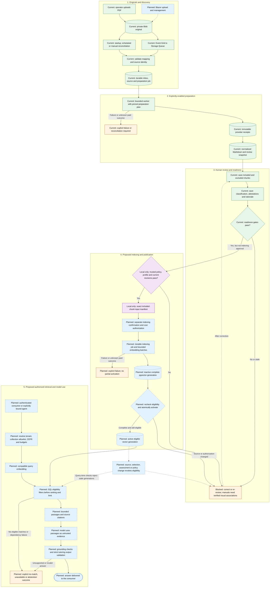

# Document RAG Lifecycle

This guide follows a PDF from upload to retrieval-augmented generation (RAG): a model answering
with authorized, cited passages from that document. It also proposes the next bounded pgvector
milestone. [ADR 0001](adr-0001-centralized-document-rag.md) remains the architectural decision
record; this guide does not accept or replace that proposal.

**Current boundary:** admission, preparation, immutable review snapshots, saved chunk selections
and document-level readiness assessments are implemented in the Debug workflow. Embeddings,
vector publication, knowledge search and model knowledge bindings are not implemented.
Saving an assessment does not start indexing or make a document available to a model.

**Local-only next slice:** protected indexing preflight now checks trusted collection policy,
pinned embedding-profile inputs, saved review revisions and input bounds. It derives a private,
content-addressed manifest containing only included candidates. This slice is not deployed and
does not create jobs, call an embedding provider, store vectors or authorize indexing.

## Data Flow

**Current** means deployed in the Debug workflow, subject to configuration and authorization,
not enabled for every collection. **Local only** means implemented and locally validated, not
deployed. **Planned** means unimplemented. **Blocked** means no downstream publication is permitted.
Labels carry these distinctions independently of color.

The diagram is a lifecycle, not one uninterrupted automatic job. Human review, indexing
authorization and model binding are separate decisions. Reconciliation discovers missed changes;
it must not silently authorize paid processing or publication.

## What Each State Means

| State | Meaning | Available now? |
| --- | --- | --- |
| Uploaded | The original is in private Blob Storage; the application may not have admitted it yet. | Operator upload; no Blazor upload/replace/delete yet |
| Admitted | A validated, tenant-qualified source and durable preparation job exist. | Yes |
| Prepared | Receipts and derived review content exist; fidelity still needs review. | Yes, for explicitly enabled preparation |
| Selection saved | A reviewer chose which snapshot candidates to include; excluded candidates and the original are not rewritten. | Yes |
| Readiness approved | The current assessment passes implemented review gates for the exact saved selection. | Yes; the preparation job remains `ReviewRequired` |
| Indexing preflight eligible | Current saved inputs satisfy configured trusted classification/profile and token bounds; a manifest identity can be derived. | Local only; never paid-operation approval |
| Indexing authorized | Trusted policy, exact revisions and a separately confirmed processing budget permit embedding. | Planned |
| Indexed | Every expected included chunk has a compatible vector in a validated, inactive generation. | Planned |
| Active/searchable | A complete generation is published and remains eligible for an authorized query. | Planned |
| Available to a model | An opted-in agent has an authorized binding and successfully obtains eligible evidence. | Planned; never implied by upload or approval |

The two initial document assessments were reported to survive browser refresh. That confirms
the user's persistence check, not that both documents passed readiness or that either is searchable.

## Existing Review Gates

The [review workbench](administration-frontend.md#document-catalogue-and-review) first saves a chunk
selection, then a document-level assessment. The assessment binds the current source, immutable
snapshot and selection revision, with an authenticated audit record.

- Classify document type, content language, optional edition and CEFR where applicable.
  The current **Reviewed language** field means the document's content language, not the
  language used to write the review.
- Explicitly attest provenance, included-content fidelity and safety; supply a rationale and
  request readiness approval. Missing attestations or an empty included selection block readiness.
- Vocabulary lists and exam papers need reviewed CEFR. Classification is reviewer metadata today,
  not an implemented trusted collection policy.
- Device manuals remain blocked until figure/caption/source associations are implemented and
  verified. A checkbox cannot substitute for those associations.
- A changed saved selection makes the assessment stale. Another snapshot does not inherit it.
  Source replacement/deletion revokes access to derived review content.

These are readiness gates, not permission to embed. See the
[assessment contract](../src/CasCap.App.Client/Models/DocumentApprovalRequest.cs) and
[server persistence rules](../src/CasCap.App.Server/Services/DocumentPreparationMarkdownStore.Approval.cs).

## Proposed Indexing Contract

The first pilot should use eligible vocabulary material. Device manuals must remain unavailable
until their visual gates are satisfied; exam material also needs its own fidelity and licensing review.
No embedding provider, model, dimensions or spending allowance is selected by this guide.

### Local Preflight Implementation

The Debug-only protected review API exposes `GET .../generations/{generationId}/indexing-preflight`,
with the same signed-in assigned-administrator boundary and `no-store` response policy as review.
The [typed client](../src/CasCap.App.Client/Services/AdministrationApiClient.cs) and
[request collection](../requests/document-reviews.http) expose the check; there is no new browser
button or live rollout in this slice.

Configure [DocumentIndexingConfig](../src/CasCap.App.Server/Models/_DocumentIndexingConfig.cs)
under `CasCap:DocumentIndexingConfig`. It defaults to `Enabled=false`, with empty `Profiles` and
`Collections`; no model is implicitly chosen. Enabled preflight requires:

- A profile with provider registration, model/revision, dimensions, cosine metric, exact snapshot
  tokenizer encoding/version and explicit per-input, total-token and included-chunk ceilings.
- A tenant-qualified collection policy with revision, one trusted document type, language,
  learning-content CEFR ceiling and profile reference. The first slice deliberately rejects
  classification mismatches instead of guessing the type of a mixed collection.

These settings are operator-owned, not supplied by the preflight caller. Invalid settings fail
startup validation. Policy/profile contents are included in the manifest identity, so forgetting
to increment a human-maintained revision does not make changed settings hash-identical.

The server reads current source, exact snapshot, latest selection and latest assessment under the
existing mutation lock. Missing/replaced/deleted sources return 404; unavailable persistence
returns 501. Unresolved policy, review or input gates return 200 with explicit blockers and no
manifest identity. An eligible response contains counts/revisions and the manifest hash, never
the private input text, provider configuration, review rationale or actor identity.

Every response retains `IndexingApproved=false`. Profile metadata/token counts do not verify
deployed model identity, credential authorization, storage compatibility, prices or a monetary
budget. The durable worker must verify those before any separately approved paid operation.
The manifest is computed, not persisted as an indexing request; future acceptance, execution and
activation must revalidate it rather than trusting an earlier successful preflight response.

### Eligibility Authority

Introduce tenant-qualified, versioned collection policy covering permitted document types,
languages, required CEFR, visual requirements and embedding profile. Reviewer classification
cannot override that policy: relabeling a manual as vocabulary must not bypass visual requirements.
Default to no indexing and require a separate confirmed indexing action.

Bind that action and its durable job to:

- The exact current source identity, ETag/content hash and stored Markdown generation.
- The saved included-chunk selection and current readiness assessment revisions.
- The trusted collection-policy revision and immutable embedding profile.
- Explicit request/token/time/retry/spending bounds and the authorized initiating principal.

Recheck those bindings before paid work, before activation and at retrieval. Reject stale or
conflicting requests explicitly. Saving an assessment must continue to make no provider call.

### Durable Work And Embedding Receipts

Create a separate indexing workflow; do not reopen the finished preparation job or repeat PDF
extraction to obtain embeddings. Reuse the proven ownership, database-time, deadline and mutation
fences in the [preparation job service](../src/CasCap.App.Server/Services/DocumentIngestionJobService.cs)
and [transaction helpers](../src/CasCap.App.Server/Services/DocumentIngestionTransactions.cs).

Use the reviewed heading-aware snapshot and its saved included ordinals, not the older
[page-local chunk entity](../src/CasCap.App.Server/Entities/DocumentTextChunkEntity.cs).
Define and hash the exact embedding input, including approved heading context; keep review rationale,
actor identities and usage metadata out of that input. Preserve original chunk and source provenance.

Workers claim bounded work, persist batch intent and record successful embedding receipts.
Do not hold a database transaction across an embedding HTTP call. Resume from compatible successful
receipts, scoped to the authorized tenant and exact input/profile; do not introduce cross-tenant
content deduplication. An unknown paid outcome requires reconciliation or operator action, not an
automatic replay or a promise of exactly-once billing.

The profile must pin provider/model identity and revision where available, dimensions, distance
metric and input normalization/version. Equal dimensions do not make different models compatible.
Validate returned vector count, dimensions and finite values before accepting a batch.

### pgvector Storage And Activation

Use PostgreSQL/pgvector as the first backend, following
[ADR D2](adr-0001-centralized-document-rag.md#d2-postgresql-stores-metadata-chunks-and-embeddings).
Keep originals in Blob Storage and review snapshots immutable. Proposed persistence needs
tenant-qualified indexing jobs, batch receipts, generation/profile bindings, vector rows with
chunk provenance and a guarded active-generation pointer.

Stage a complete inactive generation. Verify exactly the expected included chunks, vectors and
provenance, then recheck all eligibility revisions and activate atomically. Never expose a partial
batch. Failed work must not look like a successfully published empty corpus.

The ADR records completed infrastructure activation of the `vector` extension. That is not proof
of application driver/EF mapping or retrieval behavior. Verify compatible packages against
[the pinned dependencies](../Directory.Packages.props) and an isolated pgvector-capable PostgreSQL
instance before application rollout. A passing plain-PostgreSQL fixture does not establish this.
Runtime credentials must not gain extension-installation or schema-management privileges.

Start with exact nearest-neighbor search inside the authorized scope. Add HNSW only after measured
corpus size, latency and filtered-recall evidence justify it. Approximate-index filtering and vector
dimension limits depend on index/type/version; consult the official
[pgvector search guidance](https://github.com/pgvector/pgvector#querying) and
[.NET integration](https://github.com/pgvector/pgvector-dotnet#entity-framework-core).
Azure AI Search and Redis vector storage are not parallel implementations in this first milestone.

### Revocation, Replacement And Recovery

An active pointer alone must never authorize retrieval. Changing source, selection, assessment,
collection policy or access must fail closed at the server's eligibility check, even while stale
vector rows await cleanup. A request already holding evidence cannot be recalled; validate before
releasing results, and define the handling of in-flight model responses and retained history.

For a failed same-source rebuild, retain the previous active generation only if it is independently
still current and authorized. Do not retain revoked evidence merely to avoid an empty result.
Current [source admission](../src/CasCap.App.Server/Services/DocumentIngestionInboxService.cs) retires
derived state on replacement/deletion; it is not a full independently authorized source-version
lineage. Serving an older source after replacement needs explicit lineage and retention work first.
Application rollback must not implicitly reactivate stale corpus data.

## Proposed Retrieval And Model Gates

1. Authenticate the consumer and derive tenant context on the server. Add an explicit knowledge
   permission rather than treating agent execution permission as document-search authorization.
2. Resolve a tenant-local collection allowlist, embedding profile, result/token budget and effective
   CEFR from trusted consumer/session policy. Model arguments may narrow scope, never broaden it.
3. Generate a compatible query embedding. Apply tenant, allowed collections, current source,
   generation, approval/policy revisions, deletion status and CEFR predicates in SQL before
   ranking and `LIMIT`; do not fetch global top-k and filter afterward.
4. Return bounded passages, relevance information and source/page/heading citations. Source
   expansion must use the same authorization. Page/Markdown provenance exists; precise PDF
   geometry and trustworthy visual highlights must not be invented.
5. Distinguish no eligible matches from embedding/database failure. Do not return an empty success
   on dependency failure. Reference-required agents must abstain or report unavailable context.
6. Bind knowledge only to explicitly opted-in, versioned agent definitions, with an empty allowlist
   by default. Follow [ADR D5](adr-0001-centralized-document-rag.md#d5-retrieval-is-an-opt-in-runtime-capability)
   through execution, delegation, streaming, evaluation and session reconstruction.
   Evaluate the pinned framework's `TextSearchProvider`; do not add a tool to every agent.
7. Treat retrieved text as untrusted evidence, not system instructions or tool authorization.
   Validate citation/grounding behavior and prevent injected passages from becoming ordinary
   persisted chat messages. Generated answers can themselves quote sensitive source content.

CEFR is cumulative using an ordered level mapping: A2 permits authorized A1+A2 material, not B1.
Do not use lexical string comparison or trust a model-supplied level. Retrieval restriction alone
does **not** make generated German level-safe. Strict tutoring needs versioned lexical/grammar
policy and pre-delivery validation with bounded repair/abstention, including buffered streaming,
as required by the ADR. A protected search API can be delivered before that learner-facing gate;
do not advertise strict A1 model answers before it exists.

Keep query text, excerpts, document names, vector contents and personal identifiers out of
telemetry. Use bounded, payload-free outcome/cost/latency diagnostics instead.

## Proposed Delivery Sequence

Except for the local preflight noted below, these phases remain planned. None grants permission
for paid/live work.

| Phase | Deliverable | Acceptance gate |
| --- | --- | --- |
| 1. Policy and profiles | Local preflight and input manifests implemented; durable indexing request and cost authorization still planned | Local checks cover classification bypass, exact revisions, cumulative CEFR and input ceilings; confirmed job acceptance and spending authorization remain outstanding |
| 2. Durable indexing | Separate job lifecycle, fake embedding provider, batch intent/receipts and inactive generations | Duplicate claims/retries, cancellation, unknown paid outcomes and concurrent revocation cannot double-activate or publish partial data |
| 3. Native pgvector | Compatible driver/EF mappings, additive migration, exact filtered search and atomic activation | Isolated real-pgvector tests cover fresh/upgrade schema, dimensions, tenant constraints, races, restart recovery and fail-closed eligibility |
| 4. Protected search | Authorized API with compatible query embedding, cumulative CEFR and bounded cited results | Cross-tenant/collection denial, A1/A2/B1 boundary fixtures, no-match versus failure, citation/source authorization and no payload logging |
| 5. Bounded live pilot | One eligible approved vocabulary source and explicit embedding/query budget | Separately approved calls; expected included chunks only; excluded chunks absent; real citations and revocation verified without changing originals |
| 6. Opt-in model use | Versioned knowledge bindings and evaluation through actual runtime paths | Grounding, abstention, prompt-injection resistance, history retention and streaming tested; strict tutoring separately gated on output validation |

Agree the profile/model, budget and evaluation thresholds before the live pilot. Proposed minimum
checks include zero excluded/stale/cross-tenant chunks returned and exact agreement between the
saved included selection and indexed provenance. Measure relevance and latency on an authorized,
licensed evaluation set before broadening access; a successful migration is not retrieval-quality
evidence. Builds/tests require their own execution approval.

Blazor upload/replace/delete, original-PDF viewing, provisioning/bootstrap, verified manual visual
associations, alternative vector backends and approximate indexing remain separate work. This guide
records their place in the lifecycle without making them prerequisites for a bounded vocabulary
search pilot or claiming they have been delivered.
