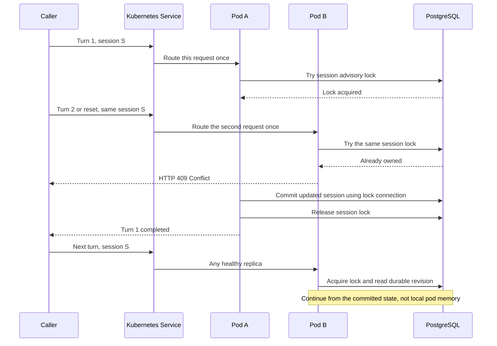

# High Availability

Agentizr can serve consecutive turns of a session from different replicas. PostgreSQL owns the
durable state and session lock; Redis is an optional payload cache, not another source of truth.
There is no sticky-session requirement.

## Why Routing Alone Is Not Enough

A Kubernetes Service sends each incoming request to one pod. It does not prevent **two different
requests** for the same session from overlapping. A turn and a reset can overlap too, even inside
one pod. Without coordination, both can load the same history and overwrite each other's changes.

## Event Flow

## The Small Set Of Responsibilities

| Component | Responsibility |
| --- | --- |
| `IAgentSessionStore` | Resumable session and named snapshot operations |
| `IAgentOverrideStore` | Per-session model, instructions and session-enabled overrides |
| `IAgentSessionLock` | Fail-fast exclusive ownership for tenant + agent + session |
| `PostgresAgentStateStore` | PostgreSQL writes and revision-checked Redis payload reads |
| `AgentRunHistoryService` | Optional durable debugging archive, separate from active state |

The coordinator holds ownership across definition resolution, model/tool execution and state/history
completion. Reset, compaction, snapshots and override replacement acquire the same lock.
The lock deliberately excludes definition version so activation cannot let two versions mutate the
same logical session simultaneously. Independent sessions can run concurrently.

## Connection-Bound Ownership

The production implementation uses `pg_try_advisory_lock` on a dedicated PostgreSQL connection.
A busy session returns HTTP 409 immediately, including before a streaming success response begins.
The handle releases the advisory lock when the operation ends; PostgreSQL releases it when the
connection is lost. Network failures can delay detection and therefore delay a replacement owner.

State writes use that **same open connection**, with no automatic reconnect. A disconnected former
owner cannot open another connection and overwrite the replacement owner's state. There are no
Redis lease tokens, renewal timers or custom expiry/fencing scripts.

One connection is occupied for each active session operation, so size the PostgreSQL connection
pool and request concurrency for expected simultaneous model calls. A connection-pooling proxy
must preserve session affinity; transaction/statement pooling is incompatible with session-level
advisory locks.

Read-only session inspection does not acquire ownership and may report the previously committed
state while a turn is in progress. It cannot observe an uncommitted half-written payload.

## Persistence And Cache Consistency

See [persistence](persistence.md) for the tables and cache flow. Each state write creates a fresh
revision. A reader checks the small PostgreSQL revision before consulting Redis for that revision's
JSON. Cache loss, old local entries or a delayed refill cannot replace the selected durable revision.
Cache outages fall back to PostgreSQL; database outages do not silently turn Redis into an authority.

Active definition selection has a different consistency contract: a five-second absolute pointer
cache by default, with explicit invalidation after activation/deactivation. A racing refill or
missed invalidation can delay a change for at most that configured cache age. Set
`ActiveDefinitionCacheSeconds` to `0` for immediate authoritative selection. Immutable definition
contents remain version-qualified.

## Failure Boundaries

- Only one session mutation owns the lock; this is **not exactly-once execution** of external tools.
  A pod can fail after a tool acts but before the session is committed. Do not blindly retry a
  failed run or stream; use tool-specific idempotency for irreversible actions.
- A turn running on a failed pod is not migrated mid-request. A later request can resume from the
  last committed state. Opt-in archived activity helps diagnose what happened before the failure.
- A stream that fails after headers were sent terminates without a final result; its HTTP status
  cannot change retroactively.
- State and terminal archive status are separate commits. If final archival fails after state
  commits, the request fails explicitly; inspect the archive/state before retrying.
- PostgreSQL server HA, backups and failover are deployment responsibilities. Failover can end a
  request and lose its connection-bound lock; this does not promise seamless in-flight recovery.
- Development without PostgreSQL deliberately uses in-memory state and locks. It is single-process
  only, regardless of whether Redis is configured.

## Deployment Checklist

1. Apply the additive migration externally, before the application rollout. Normal pods never migrate.
2. Configure every replica for the same PostgreSQL database, tenant mappings and credential sources.
3. Configure Redis for performance if desired; never rely on it as the only copy.
4. Set `ConversationHistoryEnabled=true` only after accepting the content-retention implications.
5. Publish/activate the required definitions and then increase `replicaCount`.
6. Test consecutive turns through different replicas, contention (409), and continuation after
   Redis cache eviction using the [local persistence setup](persistence.md#local-development-and-tests).

Do not mix the previous Redis-only runtime-state implementation with the durable implementation
for active conversations: they use different authorities and locks. Drain active turns and plan an
explicit state import or session reset before that first cutover. The additive database schema
alone does not migrate old Redis-only conversation data.

## Deferred API Cleanup

TODO: After this persistence batch, migrate application routes to thin controllers without changing
route constants, contracts or status/streaming behavior. Move application-owned mapping extensions
to the application `Extensions` namespace; keeping that migration separate makes HA behavior easier
to review.
