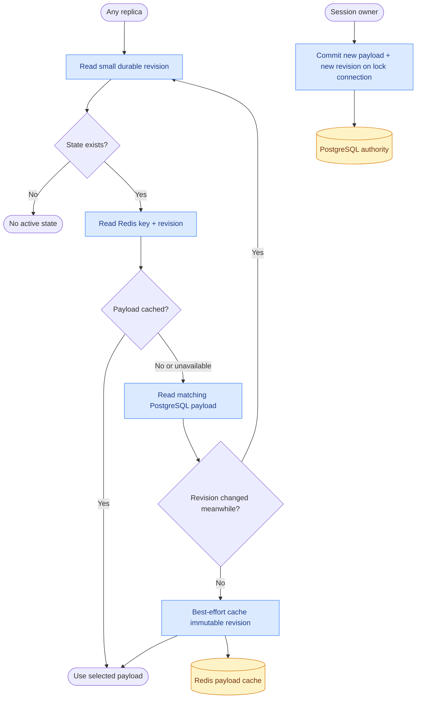

# Persistence

PostgreSQL is the durable authority. Redis accelerates reads and can be emptied without losing
committed sessions, snapshots, overrides or debugging history. Storage is behind the existing
session, override and definition abstractions; there is no configurable framework for reversing
the roles of PostgreSQL and Redis.

[CasCap.Data](../src/CasCap.Data/README.md) owns the EF Core context, entities, design-time factory
and migrations. [CasCap.Backend](../src/CasCap.Backend/README.md) owns tenant-qualified reads/writes,
session locks, transaction orchestration and cache policy; the executable host retains finite
migration lifecycle ownership.

## What Is Stored

All tables live in the `agent_runtime` schema.

| Table | Contents | Lifetime |
| --- | --- | --- |
| `agent_definition_snapshots` | Immutable, credential-free, schema-versioned definitions | Explicitly retained |
| `active_agent_definitions` | Current definition pointer per tenant/agent | Replaced on activation |
| `agent_definition_activations` | Actor/reason activation and deactivation audit | Explicitly retained |
| `agent_states` | Version-qualified sessions, named snapshots and overrides; opaque key, owning tenant/agent/session, revision and JSONB payload | Until explicitly deleted/replaced |
| `agent_runs` | Opt-in turn identity, tenant/agent/session, definition/model, timestamps, status, safe error type and output/usage/event summary | Retained independently of session state |
| `agent_run_activities` | Opt-in ordered user/model messages, tool arguments, results/failures and delegation depth, committed as execution proceeds | Retained independently of session state |

State keys include tenant, agent, definition version and session (plus snapshot name where relevant).
Activating a new definition therefore selects a separate state namespace. Returning to an old version
can recover its prior state. Reset deletes only the selected version's active session; snapshots,
overrides and historical runs remain. Compaction changes only resumable state, never the archive.

## Data Flow



The metadata lookup is deliberate: it avoids trusting stale cached mutable state without adding a
distributed invalidation protocol. Large JSON is read from Redis on a cache hit. Cache keys include
the unique write revision, so delayed old refills remain harmless. Old payloads expire naturally;
cache population is not required for a successful durable write.

`StateSlidingExpirationHours` retains its configuration name but now controls the Redis payload
TTL from population, not the lifetime of PostgreSQL records. The default is 168 hours. Reads do not
extend that TTL. Durable retention is independent and currently has no automatic cleanup.

Definitions have immutable-content caching (`DefinitionCacheExpirationMinutes`, default 60) and
a separately bounded active-pointer cache (`ActiveDefinitionCacheSeconds`, default 5).
Activation/deactivation invalidates the pointer; an embedded absolute deadline also bounds stale
refills and missed invalidations. Set the pointer duration to zero when that bounded delay is not
acceptable. Administration/audit reads and activation graph validation use PostgreSQL directly.

## Conversation Archive

Enable `CasCap:AgentRuntimeConfig:ConversationHistoryEnabled` explicitly (default `false`).
This is a debugging content archive, not a telemetry exporter or a source for session restoration.
It does not depend on the caller requesting diagnostic details in an HTTP response.

1. After preflight/definition resolution and while owning the session lock, commit a `Started`
   row and the user text before invoking the executor.
2. Commit model messages for each completed model round-trip, before subsequent tools or history
   compaction can discard them. Persist tool-started activity before invocation and tool-completed
   activity after it. Sub-agents share the sink and carry their own name/depth.
3. Commit a terminal `Completed`, `Failed` or `Cancelled` outcome. Finalization has its own bounded
   cancellation token so a disconnected caller does not prevent recording cancellation.
4. A process crash may leave `Started`. The next turn that owns the same tenant/agent/session lock
   marks such prior rows `Interrupted`. Until then, `Started` means unfinished/unknown, not proof
   the run is still alive.

Activity commits are awaited and are not buffered only in a pod. Completed activity remains
queryable when later work fails. A tool-started row without completion means its outcome is unknown.
There is no promise to retain model tokens not yet returned by the provider, or an operation killed
before its activity commit. Preflight rejection and 409 contention do not create execution rows.

The current archive is queried directly in PostgreSQL; no history HTTP API/frontend is added.
For example, parameterize the tenant/session values in your database client:

```sql
SELECT id, agent_name, definition_version, status, started_at_utc, completed_at_utc, summary_json
FROM agent_runtime.agent_runs
WHERE tenant_id = :tenant_id AND session_id = :session_id
ORDER BY started_at_utc;

SELECT id, recorded_at_utc, activity_json
FROM agent_runtime.agent_run_activities
WHERE run_id = :run_id
ORDER BY id;
```

## Privacy And Retention

- The archive stores explicit projections, never provider options, HTTP requests, authentication
  headers, exception messages/stacks, framework sessions or attachment collections.
- Known execution provider keys are redacted from archive text. Credential/header fields and
  recognized binary/image/resource payloads are omitted recursively. Input binary bytes are not
  copied into the archive.
- Prompts and tools may still contain personal information or secrets in arbitrary prose. Field
  redaction is not a universal secret detector. Do not submit credentials as conversational text or
  expose secret-returning tools; restrict database access and backups accordingly.
- Resumable framework session JSON is separate from the debugging projection and can contain
  conversation content needed by the framework, including media references/input content. Protect
  `agent_states` and its cached payloads as sensitive data too.
- Reset/compaction is **not erasure** of historical conversations. To erase data, include versioned
  state, named snapshots, overrides, run activity, summaries, caches and backups in the policy.

TODO: Define retention/cleanup once useful debugging horizons and volume are measured. Cleanup is
deferred deliberately during development; choose age/size limits and backup erasure requirements
before adding more users or treating this archive as production storage.

## Local Development And Tests

The root [Compose definition](../docker-compose.yml) owns reusable PostgreSQL and Redis services,
their standard local endpoints and storage. The IDE runs the app:

Compose loads public localhost credentials from `.env.example`, then optional gitignored `.env`
overrides. Copy `.env.example` to `.env` for local customization; never use these credentials for
deployment. Existing PostgreSQL volumes retain their original password: changing an env file does
not rotate a database role. Test connections live in the test project's `appsettings.Test.json`,
copied to its output directory and loaded optionally through the shared Test configuration chain.
Keep its localhost credentials aligned with the Compose
service when overriding `.env`. No password is required for the offline EF design-time fallback;
commands that connect must supply `CasCap__DatabaseConfig__ConnectionString` from local configuration.

```powershell
docker compose up -d --wait postgres redis
$env:ASPNETCORE_ENVIRONMENT = 'Development'
$env:CasCap__DatabaseConfig__ConnectionString = 'Host=localhost;Database=agentizr;Username=postgres;Password=local-development'
$env:CasCap__CachingConfig__RemoteCacheConnectionString = 'localhost:6379,abortConnect=false'
$env:CasCap__AgentRuntimeConfig__ConversationHistoryEnabled = 'true'
dotnet run --project src\CasCap.App.Server --configuration Release --no-launch-profile -- --migrate
dotnet run --project src\CasCap.App.Server --configuration Release --no-launch-profile
```

These are public local-only development credentials. Set the Development environment when using
the anonymous local setup. With PostgreSQL configured, publish/activate definitions through the
control-plane API; the configuration-only bootstrap adapter is not the definition authority.
Redis is optional; omit its connection setting to exercise database-only operation.

For integration tests, reuse those services:

```powershell
docker compose up -d --wait postgres redis
dotnet test --project src\CasCap.App.Server.Tests --configuration Release --filter-class '*PostgresAgentStateTests' --filter-class '*AgentRunHistoryTests'
docker compose stop postgres redis
```

The PostgreSQL fixture creates a random per-fixture database, migrates it, and drops only that
generated database at teardown. Redis tests use random tenant-qualified keys, never `FLUSHDB`.
Tests do not automatically start or stop
containers. No per-run ad hoc containers are needed. If tests are killed before teardown, their
generated `agentizr_test_*` databases may remain for manual inspection/cleanup.

Stopping keeps service data for inspection. Do not use `docker compose down --volumes` casually:
it also removes the development/provider volumes in this Compose project.

## Deployment

Apply additive EF migrations through the existing external migration job before rollout, never in
each application pod. Use PostgreSQL backups and restrict database roles. A Redis outage is a cache
miss/fallback, not a reason to accept Redis-only writes. PostgreSQL is required outside Development;
without it, only the explicitly single-process Development adapters are available.

See [high availability](high-availability.md) for ownership, connection-pooling constraints, cutover
from Redis-only state, interrupted turns and external side-effect limitations.

## Document Admission And Proposed Retrieval

[ADR 0001: Centralized document RAG](adr-0001-centralized-document-rag.md) proposes tenant-scoped
Blazor document management, private Azure Blob originals and Event Grid/queue-triggered ingestion,
with PostgreSQL/pgvector first and Azure AI Search as an optional target. The Debug ingestion role
now admits validated source events into `knowledge_documents` and `document_ingestion_jobs`, committing
the receipt/job before queue acknowledgement. These are metadata and processing intents, not vectors.
Apply the additive `DocumentIngestionAdmission` migration externally before enabling the worker.
No migration is run by API or ingestion pods.

Select `CasCap:FeatureConfig:EnabledFeatures=migrate` (or the existing `--migrate`) for the finite
schema job; it cannot combine with `agentizr` or `ingestion`. API-only remains the default and keeps
Redis optional. Ingestion requires PostgreSQL plus shared Redis leadership; losing Redis pauses
ownership rather than changing durable authority. See the ADR's
[role contract](adr-0001-centralized-document-rag.md#d4b-modular-roles-and-elected-ownership) and
[IaC handoff](adr-0001-centralized-document-rag.md#exact-iac-handoff) for configuration and PoC limits.
PDF extraction, pgvector, document UI/API and agent retrieval are not implemented yet.
