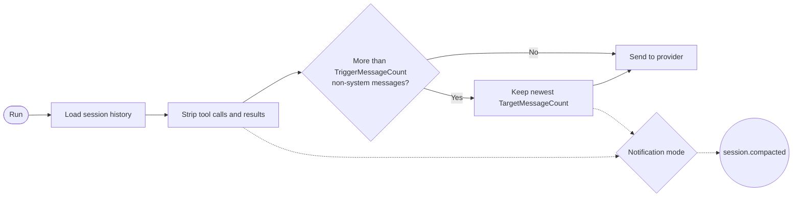

# Session Compaction

Session compaction keeps each agent's stored chat history small enough for its provider to answer
quickly. This page explains how compaction works, how to configure it per provider, and the
measurements behind the recommended settings.

## Data Flow



Before each run, `ToolOutputStrippingChatReducer` processes the stored history:

1. It keeps the first system message.
2. It strips every tool call and tool result, on every run. Tool results are the main source of
   context growth, and the model re-queries live data rather than relying on old results.
3. Once more than `TriggerMessageCount` non-system messages remain, it trims the history to the
   newest `TargetMessageCount`.

The gap between trigger and target matters for local models. llama.cpp reuses the processed prompt
prefix between requests, and a trim changes the start of the history, which discards that cache.
With a trigger above the target, the history grows for a few turns between trims, so most turns
reuse the cached prefix.

## Configuration

`CasCap:AgentRuntimeConfig:SessionCompaction` sets a policy per provider name for every tenant.
`CasCap:AgentRuntimeConfig:Tenants:<tenant>:SessionCompaction` replaces an entry for one tenant. A
provider with no entry uses the defaults.

| Setting | Default | Purpose |
| --- | --- | --- |
| `TargetMessageCount` | `20` | Non-system messages kept when the window trims |
| `TriggerMessageCount` | `20` | Non-system message count that must be exceeded before the window trims; at least the target |
| `Notification` | `WindowTrimmed` | Which compactions raise a `session.compacted` run event: `Off`, `WindowTrimmed` or `Always` |

`WindowTrimmed` reports only real trims and skips the routine tool stripping that happens on most
turns. Chat hosts such as Comms forward these events to their monitor groups.

Startup fails when a trigger is below its target or a count is outside 1 to 1,000.

### Configuration Examples

A command-style local model that only needs the last exchange or two:

```json
{
  "CasCap": {
    "AgentRuntimeConfig": {
      "SessionCompaction": {
        "EdgeGpu": {
          "TargetMessageCount": 4,
          "TriggerMessageCount": 10,
          "Notification": "WindowTrimmed"
        }
      }
    }
  }
}
```

A hosted model shared by every tenant, with a longer conversation for one tenant:

```json
{
  "CasCap": {
    "AgentRuntimeConfig": {
      "SessionCompaction": {
        "AzureOpenAi": {
          "TargetMessageCount": 20,
          "TriggerMessageCount": 30
        }
      },
      "Tenants": {
        "example-tenant": {
          "SessionCompaction": {
            "AzureOpenAi": {
              "TargetMessageCount": 40,
              "TriggerMessageCount": 60,
              "Notification": "Off"
            }
          }
        }
      }
    }
  }
}
```

## Measurements

`SessionLatencyBenchmarkTests` in
[CasCap.Common.AI.Tests](../src/CasCap.Common.AI.Tests/README.md#session-latency-benchmarks)
produced these figures on 2026-10-19:

- **Synthetic history:** each turn is a user question, a status tool call, a JSON tool result of
  about 1 KB and an assistant answer.
- **Uncompacted:** the full history.
- **Reduced:** the history after the reducer with a target of 20.
- **Uncached prompts:** each sample starts with a unique nonce, so no prompt prefix is reused.
- **Samples:** three per cell; the table shows the median time to first token.

| Turns | Local llama.cpp, uncompacted | Local llama.cpp, reduced | Azure OpenAI, uncompacted | Azure OpenAI, reduced |
| ---: | --- | --- | --- | --- |
| 0 | 75 tokens, 0.7 s | 77 tokens, 0.7 s | 61 tokens, 1.1 s | 64 tokens, 1.0 s |
| 5 | 2,982 tokens, 3.5 s | 306 tokens, 1.4 s | 2,521 tokens, 2.4 s | 288 tokens, 1.1 s |
| 10 | 5,889 tokens, 6.1 s | 537 tokens, 1.6 s | 4,980 tokens, 1.3 s | 512 tokens, 1.3 s |
| 20 | 11,730 tokens, 11.6 s | 558 tokens, 1.6 s | 9,899 tokens, 1.0 s | 508 tokens, 1.7 s |

The local model was a 9B-parameter Qwen3.5 GGUF at Q6_K on a single consumer GPU, with output
capped at 64 tokens. Azure OpenAI used a reasoning model at low effort with a 1,024-token cap.

### Findings

- **Local prefill is linear.** llama.cpp spends about 1 ms per input token before the first output
  token. Twenty uncompacted turns cost about 11.6 s per reply; the reduced history stays near 1.6 s.
- **Tool output dominates growth.** The reduced history at 20 turns holds 20 messages yet uses
  fewer than 5 % of the uncompacted tokens, because the tool results are gone.
- **Hosted models barely notice.** Azure OpenAI stayed between 1 and 2.4 s at every size; the
  variation is network and reasoning time rather than history size.
- **Uncached figures are the worst case.** In production, llama.cpp reuses the cached prefix while a
  session grows, which is why the trigger gap keeps turns between trims cheap.

### Recommendations

| Workload | Target | Trigger | Notification |
| --- | ---: | ---: | --- |
| Command-style chat on a local GPU | 4 | 10 | `WindowTrimmed` |
| Conversational use on a hosted model | 40 | 60 | `WindowTrimmed` |

Command-style agents rarely need more than the previous two or three messages to repeat or refine an
instruction. Conversational agents, such as a language tutor, benefit from a longer window, and a
hosted model absorbs its cost.
