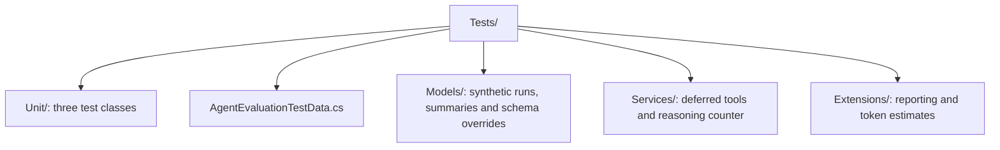

# CasCap.AgentRuntime.Evaluation.Tests

Offline .NET 10 tests for
[definition evaluation](../CasCap.AgentRuntime.Evaluation/README.md): deterministic grading,
fixture-backed tools and synthetic report data. Reporting, schema-override and reasoning-count
helpers are internal to this suite, not production APIs or a live model runner.

## Running

From the repository root, using the .NET 10 Microsoft.Testing.Platform runner:

```powershell
dotnet test --project src\CasCap.AgentRuntime.Evaluation.Tests\CasCap.AgentRuntime.Evaluation.Tests.csproj --configuration Debug
```

Debug references need the adjacent development libraries used by the solution; Release uses their
published dependencies. These tests require no credentials, model providers, remote MCP discovery,
databases or other external services. File-report tests write synthetic data to temporary directories
and remove them afterward.

## Tests

Counts are source-declared methods and expanded `[InlineData]` cases, not a recorded execution.

| Class | Methods | Cases | Covers |
| --- | --- | --- | --- |
| `AgentEvaluationGradingTests` | 6 | 15 | Numeric tolerance, whole-word exclusions, anchored patterns, composed answers and required/side-effect tool grading |
| `AgentEvaluationToolTests` | 9 | 13 | Deferred tool classification/filtering, fixtures, missing fixtures, side-effect blocking, runtime read-only pass-through and schema/description overrides |
| `AgentEvaluationReportTests` | 6 | 10 | Wilson intervals, per-cell/provider aggregation, speed ratios, temporary JSONL/Markdown reports and reasoning-character detection |
| **Total** | **21** | **38** | Offline cases |

## Trait Categories

| Category | Applied to |
| --- | --- |
| `Agent Evaluation` | All three test classes |

## Skipped Tests

None. Every case is offline and has no credential or environment-based skip condition.

## Test Layout



## Related Coverage

- [Backend evaluator tests](../CasCap.Backend.Tests/README.md) verify definition orchestration with
  a scripted model, including delegation fixtures and pass-rate decisions.
- [Server protocol tests](../CasCap.App.Server.Tests/README.md) verify the HTTP evaluation and
  activation boundaries.
- [Execution tests](../CasCap.AgentRuntime.Execution.Tests/README.md) cover model-client, tool,
  history and opt-in provider behavior.
