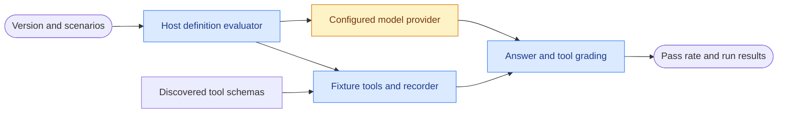

# CasCap.AgentRuntime.Evaluation

Internal .NET 10 fixture, grading and recording infrastructure for agentizr definition evaluation.
Administrators evaluate immutable definitions through the runtime API or typed administration client,
without executing the definition's external tool actions.

## Usage

Reference the [typed client](../CasCap.AgentRuntime.Client/README.md) from an administration
application and register `AddAgentDefinitionAdminClient()`. Evaluate a published version with
[`IAgentDefinitionAdminClient.EvaluateAsync(agentName, definitionVersion, request, cancellationToken)`](https://github.com/f2calv/agentizr/blob/13aa4a19180b9dbd0f14fa08fbf95f67039b69f0/src/CasCap.AgentRuntime.Client/Abstractions/IAgentDefinitionAdminClient.cs),
or send the request below to:

```http
POST https://runtime.example.com/api/v1/agents/assistant/definitions/example-v1/evaluate
Content-Type: application/json

{
  "scenarios": [
    {
      "id": "order-status",
      "question": "Has example order 42 shipped?",
      "answer": {
        "containsAny": ["shipped"],
        "containsNone": ["pending"]
      },
      "requiredToolGroups": [["get_order_status"]],
      "forbiddenTools": ["cancel_order"],
      "toolResponses": {
        "get_order_status": { "orderId": "42", "status": "Shipped" }
      }
    }
  ],
  "repetitions": 3,
  "minimumPassRate": 1
}
```

The named version must exist and offer the example tool names; adapt the fixtures to its actual
model-facing schemas. The caller needs `agent.definition.activate`, not only execution permission.
Requests carry no tenant or actor identifier: validated claims determine both.

The response contains the pass rate, aggregate pass/fail and per-scenario repetition results,
including answer/tool verdicts, tool names, timing and error reasons. The server returns
results to the caller rather than persisting evaluation reports.

## Evaluation Boundaries

- The real configured model provider is called. Evaluation needs provider connectivity and
  credentials and can incur inference cost; it is not an offline test.
- The host discovers the real service/MCP tool surface, so remote MCP discovery can require
  connectivity and its tenant credential even though tool invocation is fixture-backed.
- Query tools return `ToolResponses` fixtures or a no-data response. Actuating tools are
  recorded and sandboxed, never performed.
- Delegation tools retain their real names and descriptions but return fixtures rather than
  invoking sub-agents. Each stored definition is evaluated in isolation.
- Runtime-owned read-only time and metadata tools execute normally.
- Required tool groups use OR within a group and AND across groups. Forbidden tools and
  attempted side effects can fail a run even when the final answer is correct.
- Populated answer checks all must pass; with none specified, a non-empty answer passes.

## Activation Gate

Attach the same evaluation request as `ActivateAgentDefinitionRequest.Evaluation` to grade a
version before advancing its active pointer. A pass rate below `MinimumPassRate` refuses activation.
`AgentDefinitionPolicyConfig.RequireEvaluationBeforeActivation` can require an evaluation for every
activation, including rollback. A standalone successful evaluation is not a persisted approval.

## Configuration Examples

Minimal server policy, retaining the default optional activation gate and 120-second run timeout:

```json
{
  "CasCap": {
    "AgentDefinitionPolicyConfig": {
      "RequireEvaluationBeforeActivation": false
    }
  }
}
```

Require a passing evaluation and allow up to five minutes per scenario repetition:

```json
{
  "CasCap": {
    "AgentDefinitionPolicyConfig": {
      "RequireEvaluationBeforeActivation": true,
      "EvaluationRunTimeoutSeconds": 300
    }
  }
}
```

The timeout accepts `1`–`600` seconds. Requests accept `1`–`50` scenarios, `1`–`10` repetitions
(default `1`), and a minimum pass rate of `0`–`1` (default `1`). Scenarios accept phrase checks,
regular expressions, numeric expectations with tolerance, tool groups and fixture responses.

## Data Flow



## Internal Components

`FixtureToolFunction` preserves model-facing schemas while recording and answering tool calls.
`EvaluationRecorder` collects calls and request data; `AgentEvaluationGrader` applies answer,
required-tool, forbidden-tool and side-effect checks. `RecordingChatClient` and
`AgentEvaluationReport` provide request recording, Wilson intervals and file-based reporting for
internal evaluation callers; these reports are not an HTTP endpoint output.

Use the administration API to evaluate stored definitions; this project does not expose a
configuration-based model-matrix runner.

## Documentation

- [Host endpoint and configuration reference](../CasCap.Backend/README.md)
- [Execution infrastructure](../CasCap.AgentRuntime.Execution/README.md)
- [Evaluation and execution test inventory](../CasCap.AgentRuntime.Execution.Tests/README.md)
- [License](../../LICENSE)
