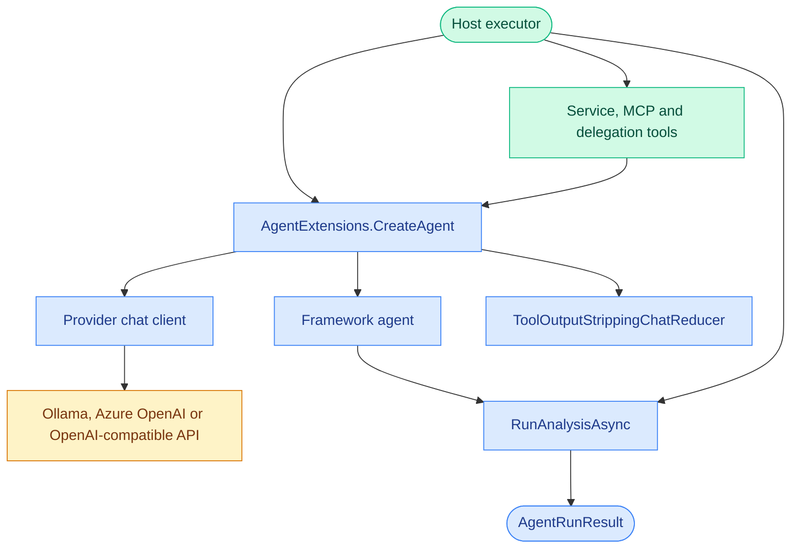

# CasCap.AgentRuntime.Execution

Internal .NET 10 execution infrastructure for agentizr: model-client construction, MCP tool
composition, sub-agent delegation and chat-history compaction using Microsoft Agent Framework.

## Ownership

An internal project of agentizr, which is its only consumer; it is not published as a package. It
keeps agent construction independent of the ASP.NET Core host, and uses the
`CasCap.AgentRuntime.Execution.*` namespaces.

## Purpose

Provides the shared infrastructure for building multi-agent AI systems with support for multiple providers (Azure OpenAI, OpenAI, Ollama), automatic MCP tool discovery from `[McpServerTool]`-decorated service types, sub-agent delegation (fan-out pattern), and context-window compaction for edge GPU devices.

This project contains **no domain-specific MCP query services**. Applications call the
[runtime API or typed client](../CasCap.AgentRuntime.Client/README.md), rather than constructing
agents or binding `AIConfig` in their own processes. The runtime host passes tenant-qualified
definitions and separately resolved credentials into this execution layer.

**Target frameworks:** `net10.0`

### Services

| Type | Description |
| --- | --- |
| `ToolOutputStrippingChatReducer` | `IChatReducer` that strips `FunctionCallContent`/`FunctionResultContent` from the history while retaining a sliding window of recent exchanges — critical for reducing context size on edge devices |
| `ReasoningMarkupFilter` | Removes `<think>` markup that a model leaked into its answer; `RunAnalysisAsync` applies it, logs a Warning and sets `AgentRunResult.ReasoningMarkupCharactersRemoved` |

### Extensions

| Class | Key Methods |
| --- | --- |
| `AgentExtensions` | `CreateAgent` — creates `IChatClient` + `AIAgent` from config (Ollama, AzureOpenAI, OpenAI); `RunAnalysisAsync` — runs inference returning `AgentRunResult`; `CreateToolsFromServiceProvider<T>` — discovers `[McpServerTool]` methods as `AITool`s; `CreateToolsForAgent` — resolves all tool sources with include/exclude filters; `CreateAgentTool` — wraps a peer agent as a callable `AITool` (delegation); `ResolveInstructions` — resolves from embedded resource, file, or inline string |

### Configuration

| Type | Description |
| --- | --- |
| `AgentConfig` | Per-agent behavioural config — `Provider`, `Instructions`/`InstructionsSource`, `Tools` (tool sources), `Prompts` (prompt sources), `Enabled` |
| `ProviderConfig` | AI provider infrastructure config — `Type` (`AgentType`), `Endpoint`, `ModelName`, `ReasoningEffort`, `ApiKey` |
| `SessionCompactionConfig` | Provider compaction policy — `TargetMessageCount`, `TriggerMessageCount`, `Notification` (`CompactionNotificationMode`) |

### Structured Responses

[`ProviderConfig.UseResponsesApi`](Models/_ProviderConfig.cs) opts OpenAI/Azure OpenAI into
Responses instead of the unchanged Chat Completions default. Azure requires an HTTPS root endpoint;
the adapter appends `openai/v1/` and uses the `https://ai.azure.com/.default` audience for Entra.
The supplied HTTP transport is retained, provider storage/background execution are disabled and
SDK retries are zero. No paid POST is automatically replayed.

[`AgentConfig`](Models/_AgentConfig.cs) adds `MaximumOutputTokens` and `JsonOutput` (schema name
and JSON schema). Strict JSON output currently requires Responses and complete, non-streaming
responses. The adapter explicitly sets strict mode, checks the provider's authoritative completion
status and rejects malformed JSON. Structured source text bypasses the reasoning-markup filter.
A caller can lower, but cannot raise, the configured Responses output ceiling.

An optional awaited `CreateAgent` structured-response observer receives the explicit
[`AgentStructuredResponse`](Models/AgentStructuredResponse.cs) text, completion, model/response
identifiers and reported usage **before** JSON/completion validation. This lets a host persist paid
receipts for malformed/incomplete responses without enabling conversation history. It is not a
generic activity callback and is not inherited by delegated child scopes. Persistence, bounds,
authorization and ambiguous-outcome recovery remain the host's responsibility; observer failures
propagate rather than permitting silent continuation.

The host honors `IncludeRuntimeContext=false` to omit its discovery tools and time context, and
`Stateless=true` to bypass its own session overrides, conversation storage and content-bearing run
history. Configured tools are separate: a tool-free definition must also leave `Tools` empty.
The host rejects session mutations/override updates for stateless definitions with HTTP 409.
These fields do not authorize a document, validate page provenance, persist paid-request receipts,
or approve fidelity. See the [preparation-agent decision](../../docs/adr-0001-centralized-document-rag.md#built-in-document-preparation-agent).

### Models

| Type | Description |
| --- | --- |
| `AgentRunResult` | Accumulated result of an AI agent run — output text, token usage, tool calls, attachments, timing, streaming support |
| `AgentRunAttachment` | Binary attachment produced by a tool during an agent run (`Base64Content`, `MimeType`, `FileName`) |
| `AgentRunScope` | Per-run host callbacks (delegation, completion, compaction, awaited tool activity), nesting depth and shared attachment collection |
| `AgentRunActivity` | Explicit tool/message observation for an optional host-owned history sink; the host owns privacy and persistence |
| `CompactionStats` | Summary of a single chat-history compaction pass |
| `AgentInfo` | MCP-friendly projection of `AgentConfig` (all properties carry `[Description]`) |
| `ProviderInfo` | MCP-friendly projection of `ProviderConfig` excluding sensitive fields (all properties carry `[Description]`) |
| `ToolSource` | Identifies an in-process `Service`, remote `Endpoint`, or peer `Agent`; remote endpoints may carry a logical `Credential` reference resolved by the host |
| `PromptSource` | Identifies a prompt source — in-process `Service` or remote `Endpoint` with include/exclude filters |
| `ToolCallInfo` | Captures a single tool/function call name and arguments |
| `McpPromptDescriptor` | Lightweight descriptor for an MCP prompt (remote or in-process) |
| `AudioDebugArtifacts` | Captures original and transcoded audio bytes for debug messages |

### Enums

| Enum | Values |
| --- | --- |
| `AgentType` | `AzureOpenAI`, `Ollama`, `OpenAI` |

## Service Architecture

The host resolves tenant ownership and persistence; this project constructs the framework agent,
provider client and history reducer used for one run:



## Runtime Integration

The host composes allowed service tools, authenticated remote MCP tools and peer-agent delegation
tools from each active definition. Remote wildcard discovery exposes read-only tools; explicitly
included mutating tools remain available to definitions permitted by publication policy.
Connections are owned and disposed per run. Root runs also receive tenant-local time and
reachable-agent/provider metadata tools.

For provider creation, `AgentExtensions.CreateAgent` returns the chat client, framework agent and
resolved instructions. Publication accepts only `Ollama`, `AzureOpenAI` and `OpenAI`, and requires
an endpoint for the first two. The execution factory can also use an explicitly supplied
`HttpClient.BaseAddress` for Ollama. Azure OpenAI requires either a key or a supplied Entra
credential; OpenAI-compatible servers use `OpenAI` with a key and optional custom endpoint.
Other provider values throw `NotSupportedException`. Model availability and multimodal support
depend on the selected server/model.

### Agent Instruction Resolution

`AgentExtensions.ResolveInstructions` resolves the `InstructionsSource` property on each `AgentConfig` using a two-step fallback:

1. **Embedded resource** — looks for a matching manifest resource name in the supplied assembly.
2. **File system path** — if the value is an absolute path to an existing file, reads it from disk.

If neither source is found an exception is thrown. The fallback `Instructions` string property can still be used for simple inline text.
This helper is broader than the HTTP publication contract: schema version 1 definitions require
inline instructions and reject instruction sources, prompt sources and arbitrary settings.

## Chat History Compaction

Long conversations accumulate large context windows — especially from verbose tool call/result JSON payloads. The host passes a `SessionCompactionConfig` to `AgentExtensions.CreateAgent`, normally chosen per provider; without one, history is not compacted.

With a policy, `CreateAgent` configures the agent's `InMemoryChatHistoryProvider` with a `ToolOutputStrippingChatReducer` that:

1. **Preserves** the first system message (agent instructions are never lost).
2. **Strips** all `FunctionCallContent` and `FunctionResultContent` from non-system messages on every run (the primary source of context bloat), dropping any message left with no remaining content.
3. **Trims** the history to the most recent `TargetMessageCount` non-system messages once it exceeds `TriggerMessageCount`.

Tool content is removed from *every* message rather than only from messages consisting *solely* of tool content. An assistant message mixing narration text with a `FunctionCallContent` would otherwise be retained while its matching `FunctionResultContent` was dropped, leaving an orphaned tool call — OpenAI and Azure OpenAI reject such a request with HTTP 400.

The reducer runs automatically before each agent invocation. A trigger above the target lets the history grow between trims, so its prefix stays stable and provider prompt caches stay warm. `SessionCompactionConfig.ShouldNotify` applies the `Notification` mode: `Off`, `WindowTrimmed` (default) or `Always`.

### Run Scope

Host callbacks and per-run state are carried by an `AgentRunScope` passed to `RunAnalysisAsync`.
For example, a host can provide its own notification callbacks:

```csharp
var scope = new AgentRunScope
{
    OnDelegation = (agentKey, depth, provider, ct) => NotifyAsync(agentKey, depth, ct),
    OnCompletion = (agentKey, depth, result, ct) => RecordAsync(agentKey, result, ct),
    OnCompaction = stats => ReportCompaction(stats),
};

var result = await agent.RunAnalysisAsync(provider, agentConfig, message, chatOptions, scope: scope);
```

| Member | Description |
| --- | --- |
| `Depth` | `0` for the top-level agent, `1` for a sub-agent, and so on |
| `OnDelegation` | Fired when a sub-agent delegation begins — use for live progress notifications |
| `OnCompletion` | Fired when a sub-agent delegation completes, with its `AgentRunResult` |
| `OnCompaction` | Fired when the chat history is compacted, with a `CompactionStats` |
| `Attachments` / `AddAttachment` / `DrainAttachments` | Thread-safe attachment collection shared with every sub-agent scope beneath the run |

`ForSubAgent()` creates a child scope with an incremented `Depth` that shares the parent's callbacks and attachment collection, so an image produced several delegations deep still surfaces on the top-level `AgentRunResult`.

`CompactionStats` carries `InputCount`, `OutputCount`, `ToolDropped`, `WindowTrimmed` and `Target`.

### Session Isolation

Each invocation uses a framework `AgentSession`. Sub-agents invoked through `ToolSource.Agent`
create a fresh stateless session per invocation rather than sharing their parent's conversation.
The runtime host owns persistence keys, including tenant, agent, definition version and caller
session identity; this project does not establish an independent persistence namespace.

## Configuration Examples

An execution-layer `SessionCompactionConfig` with defaults:

```json
{
  "TargetMessageCount": 20,
  "TriggerMessageCount": 20,
  "Notification": "WindowTrimmed"
}
```

Keep a longer stable prefix between trims:

```json
{
  "TargetMessageCount": 20,
  "TriggerMessageCount": 30,
  "Notification": "Always"
}
```

Target and trigger accept `1`–`1000`, with trigger at least target. `Off` suppresses notifications,
not reduction. The [host configuration examples](../CasCap.App.Server/README.md#configuration-examples)
show where these objects belong in provider-keyed runtime and tenant settings.

## Dependencies

### NuGet Packages

| Package | Purpose |
| --- | --- |
| [Azure.AI.OpenAI](https://www.nuget.org/packages/azure.ai.openai) | Azure OpenAI client |
| [Microsoft.Agents.AI](https://www.nuget.org/packages/microsoft.agents.ai) | Agent framework |
| [Microsoft.Extensions.AI](https://www.nuget.org/packages/microsoft.extensions.ai) | AI abstractions (`ChatMessage`, `ChatRole`) |
| [Microsoft.Extensions.AI.Abstractions](https://www.nuget.org/packages/microsoft.extensions.ai.abstractions) | AI abstraction interfaces |
| [Microsoft.Extensions.AI.OpenAI](https://www.nuget.org/packages/microsoft.extensions.ai.openai) | OpenAI provider for Microsoft.Extensions.AI |
| [ModelContextProtocol](https://www.nuget.org/packages/modelcontextprotocol) | MCP server attributes and types |
| [OllamaSharp](https://www.nuget.org/packages/ollamasharp) | Ollama .NET client |

### Project References

| Project | Purpose |
| --- | --- |
| `CasCap.Common.Abstractions` | Shared abstractions and interfaces |
| `CasCap.Common.Caching` | Redis caching abstractions |
| `CasCap.Common.Extensions` | Shared extension helpers |

## License

This project is released under the [MIT License](../../LICENSE). See the [LICENSE](../../LICENSE) file for details.
